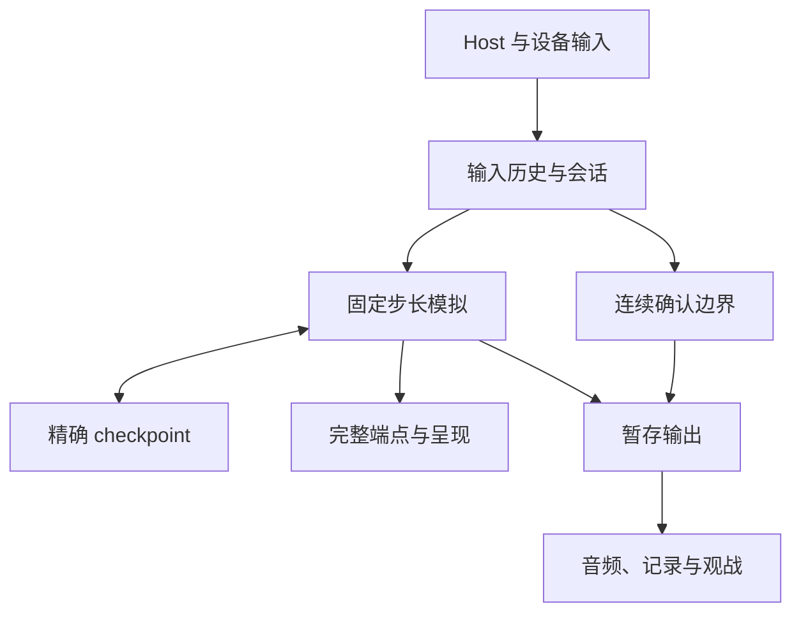
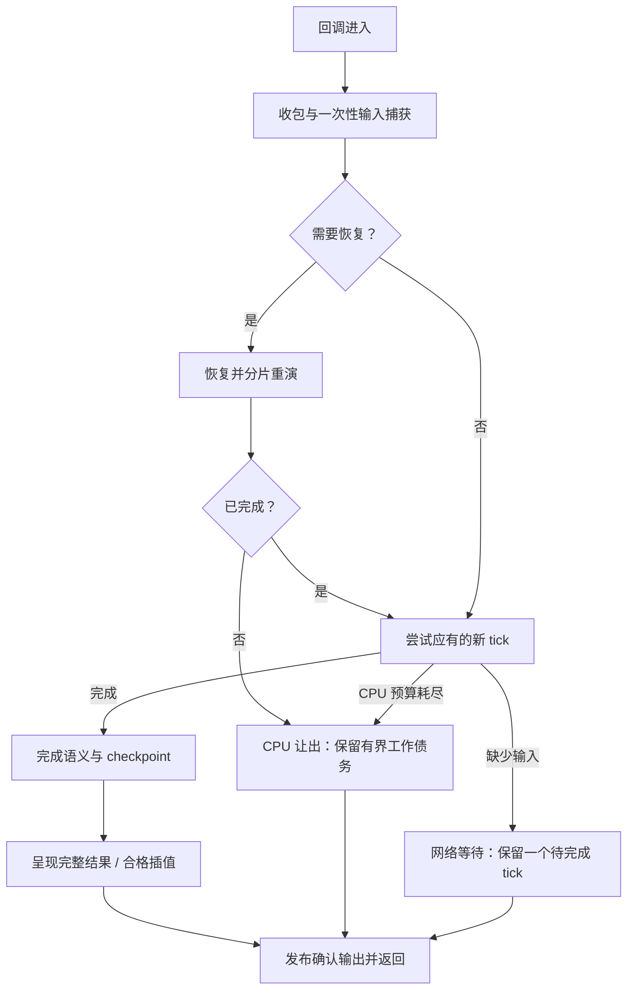

# 多人预测回滚架构：TH09 与 TH08 的成功经验

状态：有效的跨作品架构经验；各作品的适用范围和验证边界见正文。
更新：2026-10-12。本文以中文记录已实现机制、成功证据、失败尝试和迁移顺序。

## 1. 目的、权威与当前验收

目标是让预测回滚真正降低玩家的输入等待，同时保持连续、自然的画面运动。
网络信息暂时不足时可以逐渐降速；突然长时间静止、输入排队和不均匀跳步需要单独解决。
逻辑帧率、显示回调频率和玩家看到的运动连续性必须分别理解，不能用一个 FPS 数字代替。

本文补充既有 playbook，不取代目标作品的游戏语义或协议合同：

- [Multiplayer](multiplayer.md)：产品身份、房间、传输、输入与确认所有权。
- [Rollback](rollback.md)：精确恢复、性能分解、TH06/TH07 经验与失败记录。
- [Interpolation](interpolation.md)：固定时钟、高刷呈现、字段与生命周期所有权。
- [Replay determinism](replay-determinism.md)：输入、RNG、ECL、Replay 和确定性。
- [Performance and rendering](performance-rendering.md)：主线程、GPU、音频及测量。
- [Adaptation worktrees](adaptation-worktrees.md)：隔离开发与向集成树推广的边界。

### 1.1 本次成功应怎样记录

2026-10-12 17:23（Asia/Singapore），用户明确反馈 TH09 已非常流畅，
TH08 现在也“非常非常流畅”，并确认“高刷真的是完全不卡了”。
这是新增的人类体验认可，不能再用旧报告当时的“尚未体验验收”否定它。

这条反馈没有附新的设备信息、浏览器版本或已加载 WASM 哈希。
因此把“用户认可当前体验”与“下面可复现的候选构建”分别记录；
二者相关，但不冒充已在反馈设备上重新核实过构建身份。

旧异常、失败运行和未解差异仍保存，供回归时定位。
它们不撤销新反馈；新反馈也不自动证明所有设备、网络、关卡都已通过。

本轮目标与判断标准也来自用户的持续纠正：以 TH06MP / TH07MP 为性能参考，
区分停止产出输入后的自然等待与正常游玩中的 rAF 阻塞，
并要求稳定预测不被无谓制动、网络尖峰渐进降速。
用户还明确表示亲自修复并测试了所提供的 TH09 成功版本。
本文分别记录已有优化历史、用户修测确认的成功组合和后续 TH08 连续性修复，
不把整个成功归于一次改动或单轮助手工作，也不替组合中每项代码推定作者。

### 1.2 本文不是通用参数表

TH06MP、TH07MP 是长期有效的参考；TH09 和 TH08 补充了新的直接证据。
跨作品应共享所有权、调度和验证方法，不能机械复制对象布局、输入表示或预算数字。
某个优化保留在成功组合中，不等于已经测出它独立贡献了多少 FPS。

## 2. 分层：谁可以改变什么

共享基础设施优先放入 eagler-common；作品适配器负责作品自己的状态和生命周期。
不要为了消除几行胶水代码建立一个不知道作品语义的万能驱动器。

| 层 | 拥有的内容 | 不应拥有的内容 |
| --- | --- | --- |
| Launcher / Host | 房间、资源准备、设置、触控覆盖层、Runtime 生命周期 | 世界推进、碰撞位置、回滚决策 |
| Runtime 输入接收 | 消息资格、物理状态、一次性动作的接纳 | 重演时重新采样设备、直接驱动额外 tick |
| 输入历史 / 会话 | 帧号、已捕获输入、收到的实际输入、预测、ACK、确认 | 可被世界 Restore 倒退的网络时钟 |
| 浏览器传输 / relay | 信令、ICE、实际路由、输入与控制通道、定向转发 | 在中继模拟游戏或用连上房间代替输入健康 |
| 作品模拟 | 固定步长 Update、语义 Draw、RNG/ECL、游戏规则 | 浏览器到达时间或插值位置参与规则判断 |
| checkpoint / journal | 恢复所需的精确状态和明确的 owner 生命周期 | socket、DOM、设备输入源、不可逆输出 |
| 呈现 | 合格的 previous/current 对、临时插值、GPU 提交 | 改写权威碰撞位置或重复推进 ANM 脚本 |
| 确认输出 | 已确认声音、记录、Replay / 观战等作品规定输出 | 发布随后可能被推翻的预测结果 |

图中没有从 checkpoint 指向输入历史的恢复边。
这是刻意的：回滚世界不应抹掉已经收到的输入、已经采样的本地帧或 ACK 进展。

## 3. 三条时间线与前沿

### 3.1 墙钟时间

浏览器事件、网络到达、rAF、音频和用户手势发生在墙钟时间中。
各进程的 performance.now() 属于各自时钟域，不能直接相减。
rAF timestamp、callback 真正进入时间和 native 返回时间也不是同一个观察点。

### 3.2 逻辑时间

游戏仍按每 tick 1/60 秒的语义推进。
降速改变的是一秒墙钟内执行多少个固定 tick，不是把碰撞、计时器和 ECL 的 dt 改大。
恢复会让模拟游标倒退，再重演历史；这些历史 tick 不算新游戏进度。

TH08 的普通游戏和直接 Replay 保持各自原有 cadence。
MP 有自己的 fixed-tick 事务，不能把 MP catch-up 循环套到普通路径上。

### 3.3 呈现时间

显示可以在两个逻辑 tick 之间多次绘制。
呈现必须读取合格的逻辑端点，并使用与游戏调度一致的时间相位。
“又提交了一张画面”不一定表示物体移动了，也不一定表示屏幕已经物理扫描输出。

### 3.4 必须区分的前沿

| 符号 / 名称 | 意义 | 常见误用 |
| --- | --- | --- |
| next | 下一次将模拟的逻辑帧游标 | 回滚时会倒退，不能当单调进度 |
| replayEnd | 恢复前已经到达、现在需要追上的旧前沿 | 不能在 Restore 时丢失 |
| F | 恢复中取 max(next, replayEnd)，非恢复取 next | 无效 replayEnd 不能参与 max；不能拿 capture 次数代替 |
| A | 连续实际远端输入的 exclusive frontier | 不能取收到的最大乱序帧号 |
| B = max(0, F − A) | 尚缺实际输入的信息量 | 不能独自区分网络慢与远端生产慢 |
| confirmed | 连续真实输入已到齐的输入确认前沿 | 不保证纠正或外部提交条件已完成 |
| 可提交输出边界 | 输入已确认、纠正已完成、已模拟且不再被保留 checkpoint 推翻的区间 | 不能只凭 confirmed 播放或保存预测结果 |
| presented | 已实际提交的完整可显示状态 / 插值 | 不能直接当物理 input-to-photon |

性能窗口宜在同一 session / generation 和有效场景边界内，用 F 的首次跨越定义，保留之间所有 callback。
生命周期提前结束恢复时，旧 replayEnd 随之失效；重开与跨场景计数不能直接拼接。
按可倒退的 next 筛选会丢掉中间样本，拼出并不存在的长间隔。

## 4. 一次浏览器回调的状态机

共同目标是让输入与网络尽早得到处理，让恢复有界让出，并及时显示完整结果。
下面描述不变量；具体顺序和返回码由作品适配器负责。

这里的“发布”仍以可提交输出边界为前提；未完成恢复不能泄漏半恢复状态。
例如 TH08 的 Commit 还检查 Correcting / RollbackFrame，并以 LastFrame 和
FirstCheckpoint 限制提交范围。输入 confirmed 前进本身并不具备这些保证。
网络阻塞与 CPU 恢复让出必须区分：前者等待信息，后者仍在偿还已经发生的模拟工作。
图中的债务必须有界；是否保留额外到期 tick 和新增 elapsed，需要按作品明确选择和验证。
不能把“保留一个待完成 tick”扩展为所有恢复分片都必须停表；见 4.4–4.5。

### 4.1 输入应在昂贵恢复之前发出

TH09 已采用：Pump → 检查 Ready → 捕获未捕获前沿 → flush → Restore。
对方因此能在本端恢复时收到新输入，不必再承受“先恢复、后采样”的额外等待。
历史 tick 使用保留输入，不能消费新的 pulse、拖动或 auto-fire 状态。

### 4.2 完成恢复后，不要忘记原本应有的前进

恢复重做的是旧工作，本 callback 原来欠的新增逻辑 tick 仍然欠着。
TH08 当前路径在完整恢复后允许尝试这个 forward，避免恢复持续挤掉新状态。

TH09 的实现并不完全相同：最后一个历史 tick 恰好耗尽预算时可以先 yield，
下一次再继续；不能把两作描述成逐行相同的恢复尾部策略。
它们共同保证一次采样所有权和完整恢复边界。

### 4.3 预算是“开始下一项工作的门槛”

预算检查不能抢占已经开始的原子 tick、Restore 或 Draw。
超过 8 ms / 10 ms 的 callback 不会仅因超过数字就变成调度错误。
真正需要避免的是在已耗尽预算后继续启动大量额外历史工作。

| 位置 | 当前作用 | 不能宣称 |
| --- | --- | --- |
| TH09 历史恢复 8 ms | 在历史 tick 之间决定是否继续 | 每次 callback 必小于 8 ms |
| TH09 外层 10 ms | 完成 tick/render 后停止追加 due tick | 等同 TH08 的高刷插值门槛 |
| TH08 history / new tick 8 ms | 控制追加模拟工作 | 所有成本已被硬限制 |
| TH08 v7 最终 Draw 10 ms | 决定是否开始最后一次只读插值绘制 | Draw 本身一定在 10 ms 内完成 |

### 4.4 等待与相位不能互相吞掉

重试已经到期的 tick 时，不应再等一个新的 1/60 秒信用。
网络等待与 CPU 让出不能仅因“本回调没有新 forward”就使用同一种停表规则。

| 原因 | 保留义务与边界 |
| --- | --- |
| 缺少实际输入，无法前进 | 保留一个已到期的 pending tick；等待期间不累计新的墙钟预测债 |
| CPU 预算使恢复或额外 tick 让出 | 保留有界的未完成工作；额外到期 tick 与新增 elapsed 是否保留必须显式实现，不能无意丢弃 |

TH08 当前将网络等待和恢复分片都映射到一个 pending tick，期间不累计新 elapsed；
只有普通 CPU defer 退还尚未执行的到期 tick。这是 TH08 当前已采用的策略，不是跨作品要求。
TH10 r2 照搬后出现了下面的 4× 退化，因此不能凭 TH08 的体验认可省掉新作对照。

完成 callback 的小数余量需要保留。
如果“刚好完成但耗时偏高”也每次清相位，恢复会人为降低正常推进率。
归还 tick 不得重复记账，也不改变固定 dt、输入捕获所有权或真实预测前沿。

### 4.5 TH10 迁移实证：CPU 恢复被误当成网络等待

TH10 隔离树为 `D:/workspace/eagler/worktrees/th10-rollback-smoothness`。
r2 在独立 headed Chrome、实际本地 RTC、应用层发送注入单向 50±5 ms（非测得 RTT）、双方 CPU 4×、墙钟触控 120 Hz 下，
两端逻辑推进从 baseline 的 59.723/59.691 Hz 降到 51.813/51.956 Hz，正确性与前沿断言仍通过。
这是已保留的退化样本，不能用 PASS 或更短的部分 callback 宣称性能改善。

源码链是 `ApplicationHost` 回滚分支中的所有 `!advanced` → `recovering()` → `blocked(true)`。
`PendingFrameSchedule::advance()` 在 retry 时只返回 1，忽略新 elapsed；
若第一次让出时 `offered-completed>1`，又只保留一个 pending，并跳过尾部 defer，额外到期 tick 也丢失。
这两条丢时钟路径已由源码确认；它们各自解释了多少降幅，不能仅凭回调结束时间近似统计断言。

r3 已仅在 TH10 区分两类等待：仍在 `Correcting()` 时清 retry，归还 `offered-completed`，
后续回调重新累计有界的新 elapsed；真正缺输入时继续保留一个 network pending。
从 network pending 转入 CPU 恢复不会追补过去的网络等待时间；本次归还后不能再执行尾部 defer。
8 ms 工作门槛、完整恢复才能呈现、一次性输入捕获和缺口渐进制动均保留。
r3 的针对性原生 pacing 测试通过，但同条件正式包 RTC 复测仍未恢复到 baseline：
两端逻辑推进为 54.141/54.276 Hz，P0 Present 仅 50.702 Hz，新增逻辑帧间隔 p99 为 62.9 ms。
因此 r2、r3 都不能推广；时间记账正确只是必要条件，恢复分片与最终呈现仍需整场性能验证。
该修复不修改用户已认可的 TH08 / TH09 实现。

原始 r2 证据：`D:/workspace/eagler/worktrees/th10-rollback-smoothness/artifacts/rollback-smoothness/candidate-r2/rtc-touch120-cpu4-delay50-jitter5-headed-rtc15s.json`。
原始 r3 证据：`D:/workspace/eagler/worktrees/th10-rollback-smoothness/artifacts/rollback-smoothness/candidate-r3/rtc-touch120-cpu4-delay50-jitter5-headed-rtc15s.json`。

### 4.6 恢复分片太短，也可能增加卡顿

分片为浏览器让出执行机会，也增加了下一次收包重新触发 Restore 的机会。
“每片至少执行一个完整历史 tick”并不保证恢复游标净前进；刚重演过的预测前缀仍可能被新的实际输入推翻。
这类重复是合法纠正，不能通过忽略晚输入、提前呈现未恢复世界或放宽确认边界来消除。

TH10 r3 的稳定 4× P0 窗口中，329 个未呈现 callback 全部仍在 Correcting，
其中 149 次恰好只剩一个历史 tick；其余 720 个已完成 callback 都已呈现。
至少 30 对连续恢复片在执行过历史事务后游标仍未增加，证明存在前缀重启。
其中一段在缺口 4→2、scale 始终 1 的情况下反复停在恢复尾部，完整 callback 的结束间隔达到 67.5 ms。
这一段的画面停留不能归因于网络渐进制动，也不能归因于“恢复完整后被最后 Draw 门拒绝”。

因此迁移预算时，要同时检查单 callback 尾部、恢复完成间隔和整场净推进率。
若尝试给“只差最后一个历史 tick”的恢复增加完成机会，仍应保留同一个墙钟起点、明确的时间与数量准入门，
并完成原事务后才返回。此策略在 TH10 尚属实验；不要把待测阈值写成所有作品通用配置。
r6 已实现普通历史事务 8 ms、只剩最后一笔历史事务时 12 ms 的准入门，
保留最多 6 笔与至少完成第一笔事务的规则；原生边界测试通过。
12 ms 是开始下一笔完整事务的门槛，不是 callback 时长保证。
r6 正式包真实 rAF / RTC 的 1× 双端逻辑推进为 59.839/59.897 Hz，完整状态和音频一致；
但 P0 的 cadence 门仍未通过，零 recovery yield 也不能证明尾部宽限没有被使用。
4× 的 900 帧运行虽通过状态与音频校验，逻辑推进仅 7.534/7.602 Hz，
最长推进间隔 834.3/780.9 ms，因此性能严重不合格，不能推广。
随后用同一个独立 relay 的原正式包作 480 帧对照；在共同的 179→527 连续窗内，
原版为 19.127/19.630 Hz，r6 为 8.975/9.154 Hz，双方都未达到流畅目标。
这是两次顺序单样本；不能将全部差异归因于代码，也不能用原版异常替候选免责。
原版 P1 在整轮 rollback/resim 计数均为 0 时仍出现 185.6 ms native callback，
说明普通推进与外部调度的成本也必须继续隔离。先前原版约 59.7 Hz 的稳定证据仍保留。
完整样本、身份与窗口边界见 TH10 工作报告及
`D:/workspace/eagler/worktrees/th10-rollback-smoothness/artifacts/rollback-smoothness/r6-baseline-matched-window.json`。
原始 r3 证据与零基行号定位见 TH10 工作报告及上面的 r3 JSON。

## 5. 输入捕获、发送和触控

### 5.1 一帧采样一次

输入采样、传输重发、预测和重演是四件事。
一个逻辑帧已经捕获后，即使重发十次、回滚八帧，也不能再次读取 DOM 或设备。
D0 表示没有额外排队的本地输入帧，不表示零预测、零回滚或零物理延迟。

按钮也要按语义分类。
TH09 可保持射击 / 蓄力、低速和方向；Bomb、菜单动作需要实际输入。
不能为减少纠正而无条件预测所有按键，也不能凭空制造 release edge。

### 5.2 同回调旧尾与新尾合并

TH09 观察到 Pump 发旧输入尾部，紧接着本地 capture 又发完整新尾部。
common 512353c 仅在明确即将连续捕获时，暂缓 ordinary input。
暂缓发生在 sequence 分配与编码之前，随后发送包含新帧的完整尾部。

必须保留以下出口：

- due repair、控制、退休及保守背压路径按原合同处理。
- capture 成功、拒绝、Pump 失败或未 Ready 都完成旧发送义务。
- Restore、Prepare、yield 和提前 return 前 flush。
- 跳跃安排输入的调用者，在可能覆盖历史环槽之前先 flush。
- 独立 timer pump 不应因“可能很快有输入”无限等待。

实测重复对 P2 519→0、P1 321→1，wire tape 和确认状态一致。
这是发送形状改善，不能换算成对应比例的 CPU 提速。

WebRTC 快速输入与可靠控制 / 修复有各自合同，WebSocket fallback 也要实测。
有界可靠修复可以补快速通道缺帧，不能修复所有通道同时中断。
actual direct、TURN 与 relay 以实际选中路由为准，不能由启动参数推断。
独立 relay 减少部分共享执行环影响，但仍有自己的队列、事件循环和发送开销。

### 5.3 绝对目标与一次性位移不能混用

TH09 的 DirectTouch 是持有的绝对场地目标。
在被模拟的那一帧，所有 peer 根据各自一致的权威位置计算移动。
若发送端按发送时的世界位置预先算速度，接收端稍后应用会出现绕手指移动等错误。

TH08 的 fresh delta 是新的位移量，必须只转移一次给逻辑输入所有者。
没有新位移时预测零新增 delta；已经接收但尚未应用的 remainder 由同步模拟负责。
不能照搬 TH09 的“保持绝对目标”，变成每个预测 tick 重复施加一次拖动。

改输入表示会影响编码、Replay、状态哈希、reset 和回滚库存。
它不是只换一个 predictor 分支的局部性能修改。

### 5.4 managed 触控接收不能等待资源队列

两作都发现了输入入口与异步资源 / 文件系统命令共享队列的问题。
键盘已走快路，并不证明触控也及时。
触控移动、控制和取消应在有效消息已派发时及时提交 native。

快路仍必须验证 source、origin、protocol、game、epoch 和当前 document owner。
initialized、core 存在、launched、异步 launch settled 是不同状态。
同一个 WindowProxy 和 epoch 不能单独证明 iframe 仍是原 document。

不要强制 document.hasFocus()：合法父层 overlay 可以拥有焦点。
隐藏、关闭、退休、切换控制策略和观战时应按合同拒绝或中和输入。
快路不在 handler 里主动 tick、draw 或 pump，也无法抢占尚未派发的 message task。

### 5.5 动作 serial 与生命周期

source serial 记录已见过的发送端动作，mapped serial 表示真正获准提交的动作。
通过消息来源门禁、但当前生命周期不接纳的输入仍消费 source 基线，不能恢复后补发旧动作。
未通过 source / origin / protocol 等入口验证的消息不得影响这些基线。
中和输入不应生成新动作；cancel 保留作品原有 fire toggle 和 pulse 语义。

TH08 新接收器 11/11 通过，旧源码两个资源 / FS 队列用例实际失败。
TH09 真实 listener 对照中，旧版 57 个目标有 40 个失败，候选达成 57/57。
这些证明接收顺序、资格和 ACK；不等于已经测得物理触控延迟。

## 6. 信息不足时渐进降速

TH09 的已采用规则先处理到达输入，再使用连续输入缺口 B。
目标是让稳定预测留有空间，并在接近历史上限时平缓减速。

目标间隔倍率为：target = 1 + clamp((B − 4) / 3, 0, 1)。

| B | 目标间隔倍率 | 说明 |
| ---: | ---: | --- |
| 0–4 | 1 | 固定免制动区间 |
| 5 | 1⅓ | 开始减慢墙钟推进 |
| 6 | 1⅔ | 更接近预测边界 |
| ≥7 | 2 | 最多约两倍间隔，仍有有限预测上限 |

倍率每 50 ms 最多增加 1，每 150 ms 最多减少 1。
已有 phase 校正在约 0.98–1.02 内微调；制动生效时按源码取较大倍率。
清理、未 Ready、非对应模式或不期待输入时按合同复位。

### 6.1 不要把固定死区写成自适应 RTT

认可 TH09 使用固定 4 帧免制动区间，没有自动学习稳定预测深度。
50 ms RTT 与单向 50 ms 不同。若两个方向各增加 50 ms 发送延迟，额外 RTT 约为 100 ms；
只给一个方向增加 50 ms，则额外 RTT 约为 50 ms。实际 RTT 还包含原有网络和排程延迟。
60 Hz 下的预测需要量还受采样相位、传输和输入调度影响，不能仅由一个“50 ms”断言必为 2 帧。

当前规则不把本地 callback 耗时作为降速目标。
但远端 CPU 慢、浏览器迟派发或输入生产中断，也会造成 B 增大。
因此“依据输入不足”不能进一步等同于“原因已证明只在物理网络”。

### 6.2 只缩放新增时间

TH08 NetworkFrameSchedule 归一新进入的 elapsed，小数 debt 不重复缩放。
插值 alpha 使用同一条调度时钟下的剩余逻辑相位。
降速以后仍按固定墙钟 16.67 ms 计算另一条 alpha，可能使端点到达与插值脱节。

恢复有效时 F 使用 max(next, replayEnd)，非恢复时使用 next，避免游标倒退产生虚假预测余量。
A 必须连续，避免乱序晚包掩盖前面的洞。
收到数据后先 Pump，再判断缺口，避免把已经排队的数据当成尚未到达。

### 6.3 输入完全停止时有自然边界

预测历史有限，不能在完全没有实际输入时无限推进。
对方正常暂停、隐藏或停止产出后，本端最终等待是自然现象。
需要追查的是正常游玩中为何突然不再生产输入，而非强迫另一端永远单方面运行。

## 7. 语义 Draw 与高刷呈现

TH08 MP 的每个 fixed tick 包含完整 Update、semantic Draw 和四类 journal End。
省掉其中有状态语义的 Draw，可能改变游戏、动画、临时文本或下一 tick 的起点。
额外高刷 Draw 是另一个经过资格判断的只读呈现路径。

TH09 历史 tick 也保留语义 Draw，只省已证明可以省的 GPU submission 和部分纯几何。
TH09 认可版本没有 TH08 那套独立的无新 tick 高刷插值路径。
因此不能把 TH09 的外层循环形状原样视作 TH08 的高刷方案。

### 7.1 TH08 的“FPS 不掉却顿挫”

v6 的一条实际记录中，正常相位约 0.13603，却提交了语义终点 alpha=1。
结合回调耗时和源码分支，该记录与预算耗尽后提前提交端点的路径一致。
探针未直接记录预算分支标志，因此这里是由运动记录和源码共同支持的判断。
随后相位约 0.41053、0.68053、0.97101 的三次新 Draw 仍显示同一子弹位置。
这些回调并非还在恢复；显示提交继续增加，运动却先跳到终点、再保持不动。

显示过终点后，不能继续在旧起终点中间插值，否则会倒退。
该例如果直接去掉 presentation gate，会倒退约 0.556 像素。
所以修复方向不是删除 gate，而是减少不必要的提前终点呈现。

### 7.2 v7 给最终插值留出短窗口

TH08 v7 保持 history / new tick 的 8 ms 预算，
将最后一次只读插值 Draw 的开始门槛设为 10 ms。
完整恢复、语义 Draw、End 顺序和已呈现终点后的防倒退保护仍保留。

两端对应 hold 片段从 60/55 降到 12/9；
按稳定对象观察时间归一，从每秒 4.406/4.024 降到 0.951/0.713。
逻辑推进约 45.58→45.66 Hz，改善并非靠进一步降速得到。

这只支持该类连续性信号明显减少，不是“整体性能提升 80%”。
观察对象、合格片段和两轮实际触控轨迹有范围限制，原始记录继续保留。

### 7.3 最终像素与对象生命周期

TH09 认可构建移除了最终 sprite 顶点的整数取整，保留原有 −0.5 像素栅格偏移。
前面用了浮点输入和插值，最后再取整，仍会抹掉亚像素连续性。
不能把“保留小数”误写成把所有 half-pixel convention 都删掉。

previous/current 必须按 generation、owner、脚本和可见性等资格关联。
对象复用、瞬移、冻结、重生、切脚本和资源替换时应按作品规则 snap 或重建端点。
插值位置不能参与碰撞、收点、isOnscreen、目标选择或状态机判断。

重复 Draw 的临时写入应恢复为语义 tick 完成后的 authored current 状态。
文本与临时绘制队列不能被第一张高刷画面提前消耗，也不能每次重复生产。
“高刷能玩”不自动满足完整 Presentation Lab 的 owner 覆盖与纯度准入。

## 8. 日志、资源与确认副作用

### 8.1 优先减少重复工作和登记次数

先分开普通推进、捕获、恢复、重演倍数、几何、提交、音频和诊断成本。
稀疏日志不是只追求字节最少：大量小块索引、分配、跨边界复制也可能昂贵。
容量应在 rewind、confirm 和环槽复用间合理保留，避免刚释放又立即申请。

TH09 使用完整 AnmVm 的固定身份分页首次写入。
wasm32 VM 为 676 B，每页 64 个、43,264 B；整槽和单 part 共用首次写入位图。
物理 record 保留分配容量，但每 checkpoint 的有效位图、顺序和计数独立。

Enemy 固定池有 slot 首写索引，陌生 owner 保留原指针表 fallback。
容器、多态对象、unique_ptr 和资源生命期不能像普通 POD 一样跨 checkpoint 覆盖。
Seal、Save、Restore 的 observer 解除规则必须显式维护。

### 8.2 TH08 的块数与字节取舍

TH08 ScreenEffects 的固定槽捕获登记由 1,024 块变成 2 块。
v6 这项批量方案相对 v5 多保存 1,792 B，换取减少登记和重复遍历。
不能宣传为这一个改动同时减少了所有字节。

另一固定世界场景的日志峰值从 692,382 B 降到 605,390 B，
减少 86,992 B，约 12.56%；这是指定场景的日志指标，不是整机性能百分比。
块数、有效保存字节、保留容量和真实 CPU 时间应分别报告。

### 8.3 精确数学快路与缓存

缓存必须覆盖真实输入、舍入模式、精度和生命周期，并为异常值保留原路径。
浮点异常标志也是可观察状态：命中须恢复原调用的输出与后置 flags。
输入输出部分重叠且别名形态不在缓存合同内时，应走原路径，不能仅凭相同初始字节复用。
不能为速度启用改变游戏结果的重结合、fast-math 或容差化 canonical 检查。
TH08 camera、Background 数值、projection 分别有 24/11,856、12/310,860、
24/43,657 的模式 / 检查记录；这些是正确性证据，不是 FPS 改善量。

### 8.4 确认输出与资源边界

音频、记录和观战输出应按作品合同暂存，确认后按顺序发布一次。
回滚推翻的帧丢弃旧命令，重演重新生成；不能重复播放 Bomb 或触发外部保存。
音频 pump 属于持续服务工作，不能被无界恢复长期饿死。

菜单动画可以参与回滚；真正释放或替换世界资源的动作需要确认与寿命屏障。
TH09 对 speculative menu resource action 有明确拒绝路径。
资源写、读回、释放、纹理修改和 renderer flush 屏障不能在批处理时漏掉。

### 8.5 第一帧之前的动画图也必须一致

TH10 迁移时，定向放大一端开场轮询次数，能在首次历史回滚之前造成失步。
原 r4 在双方已完成并确认第 59 帧时，GUI 的三个 ANM 句柄相差 170，
visual RNG 调用次数为 16 / 0，Stage 与 StageVM 字节相同；
投影缓存此时两端均为零命中。关闭缓存、保留对象布局的对照也复现了分歧。
因此“局部缓存数值通过，但整场 canonical 不同”需要先按阶段定位，不能直接归因缓存命中。

开场资源等待使用真实两秒，而等待期间原本仍允许普通 ANM / Common tick。
不同加载或轮询节奏会留下不同的动画分配历史、句柄和活 VM；
进入世界时只重置 RNG 的 seed / calls，无法同时恢复这些 owner，
留下的动画还可能在 seed 重置后继续消费视觉随机数。

TH10 的最小修复在预配置的新会话中保留两次必要开场 Draw，
继续服务资源加载、真实等待和网络，但在等待期间冻结额外语义 tick。
定向复现中，修复前启动轮询为 410 / 71 次并失步；
r5 修复后仍为 354 / 61 次，但第 59 帧完整 canonical 相同，ANM 游标均为 31，
visual RNG 调用均为 0，且尚未发生回滚。随后第 315 帧最终共同确认的 canonical / 音频也一致。
这验证了该启动分歧的修复，不是整作性能或所有生命周期的验收。
此门依赖产品已验证的“configure 在首 tick 之前”生命周期，
不等价于任意晚配置后都能重建整个初始世界。

验收至少保留一次共同确认的开场 canonical 与最终 canonical，
并记录首次回滚发生位置；终场单一 hash 只能发现差异，不能说明它在哪里出生。
定向原始证据与后续状态见
`D:/workspace/eagler/worktrees/th10-rollback-smoothness/docs/multiplayer-smoothness-20261012.zh-CN.md`。

### 8.6 新局校准仍可能收到旧局包

RetireRun 成功不表示旧局消息已经从网络中消失。上一局终态 ACK 及其重传、
输入尾包、会话控制和阶段报告，仍可能在较快一端进入下一局校准后到达。
终态 ACK 缓存和退休 pump 应继续服务较慢对端，不能为避免报错直接清掉。

TH10 向下一局 AdonisConnection 显式提供已成功退役的旧会话配置。
校准提交前，仅完整解码且符合该旧会话、人数与角色要求的 Input、Session 和 ADP 包
可以被忽略，不进入新局输入核心。陌生会话和当前会话提前到达的 gameplay
继续保留严格失败行为；Prepare 默认不启用此例外，Clear 清除旧标识。
旧 ADS 校准包遵循 AdonisStartup 原有规则，本次没有扩大或改写其验证范围。

common `7766625` 已通过原生对照：同一份 44 字节旧 ACK 在原头文件上令校准失败，
显式提供 retired 配置后被正常忽略，既有 Adonis startup 套件也通过。
随后在两独立桌面进程、实际本地 RTC、v4 纯 Delay / D1 的原始 SDL 菜单路径中，
观察到旧局第 154 帧的终态 ACK 缓存字节在新局校准期间到达；
接收函数正常返回，新局完成 129 次 probe / 120 次 reply，并继续到共同确认边界。
这个生命周期观察已完成，整条测试仍因新局 scene / chain 的原始 canonical 不同而失败，
不能作为完整正确性或 rAF 性能验收。其余门禁、原始 owner 字节与失败报告均保留。
已移除的自动 wipe Retry 与仍可达的手动 Restart 应分别记录，
过时的自动 Retry 夹具不能代替实际菜单路径验证。

## 9. 两作成功过程与没有采用的方向

| 阶段 / 机制 | 已证明的作用 | 应保留的限制 |
| --- | --- | --- |
| TH09 完成状态及时呈现 | 修复“未走到最后 due tick 就预算退出”的呈现饥饿 | 早期正式 4× 仍约 31 Hz，不能改写为当时已达标 |
| TH09 renderer / 存储复用 | 固定完整渲染带减少提交、buffer replacement 和临时分配 | 不等于整机 CPU 按相同比例下降 |
| TH09 提前采样与缺口制动 | 输入早发、有限余量内逐渐降速 | 固定死区，未区分输入缺口的全部来源 |
| TH09 VM / Enemy 首写 | 固定 owner 去重、页面复用、精确恢复 | 单项整场速度贡献未全部隔离 |
| TH09 held target、managed、D0、亚像素 | 输入语义与最后呈现边界组成认可版本 | 不把后来独立树优化倒算进来 |
| TH08 完整恢复和 pending tick | 不以半恢复状态呈现，避免恢复吞掉原应有前进 | 普通游戏 / Replay cadence 仍独立 |
| TH08 日志与精确快路 | 降低已识别重复成本，正确性门禁有证据 | world 八场景仍限 stable-stage Update / semantic Draw |
| TH08 managed 与 v7 插值窗口 | 接收队列问题复现修复；hold 信号显著减少 | 正式端间成本差异尚未解释 |
| 2026-10-12 用户反馈 | 两作体验得到肯定，TH08 高刷连续性被明确认可 | 反馈设备没有新附构建哈希 |

以下尝试没有因此成为默认方案：

- 为压低重演次数增加本地 D，或无条件缩小预测窗：会增加控制等待或更早硬停。
- 整个跳过 Draw、仅画一个预测自机：可能破坏语义或让可见位置脱离碰撞权威。
- 照搬 TH07 checkpoint span 3：其他作品的资源和输出保留边界仍需证明。
- 通用 TouchMany / bulk 原型、紧凑打包、O3/LTO：正确或字节少也未必更快。
- TH09 Audio SIMD：逐位组件可通过，实际混音存在更慢结果；认可版关闭。
- TH09 提前制动实验 C：保留约 31 Hz 的严重不利样本，未采用。
- TH09 GPU 单开关：A 坏→B 好→A 也好，未建立可逆因果，未作为修复。
- 直接删 TH08 presentation gate：会让已经显示的端点向后退。
- 在正式包混入诊断扫描：TH09 曾发现 Release 未定义 NDEBUG，需显式 DEV 隔离。

## 10. 如何测量，才能发现真正的坑

### 10.1 性能、正确性和体验分别成立

| 证据 | 可以证明 | 不能外推 |
| --- | --- | --- |
| 源码 / 合同检查 | 某条路径及所有权设计存在 | 实际游戏已进入该路径 |
| 精确组件 oracle | 指定状态、数值或接收顺序正确 | 全世界、全部关卡正确 |
| 三世界 / rollback 对照 | 指定输入与覆盖中的恢复一致 | 实时网络和呈现一定流畅 |
| 正式浏览器运行 | 实际路由、构建和该场景的推进 / 间隔 | 所有设备或物理显示时延 |
| 对象连续性分析 | 合格身份窗口内的保持、跳步、倒退 | 所有视觉层的主观质量 |
| 用户实际反馈 | 反馈者的实际游玩体验 | 未提供的设备、哈希和全网络条件 |

“PASS”通常只表示运行结束且指定门禁通过。
应同时报告合格覆盖、异常、未捕获输入、结束边界和清理结果。

原始字节比较还依赖布局前提。TH10 手动重开诊断中，Hints 的 pending / retained 列表
共 16 个哨兵 `ListNode::value` 按设计等于本端 Hints 地址；这些字段可以因分配地址不同而合法地不同。
此轮已比较的玩家、弹幕、RNG、ANM 主池和音频分项相同。
已导出的 scene owner 字节差异全部落在这 16 个合法自指针；完整 scene 还包含未导出的 Hints 池。
因此应继续核对 owner 身份、池槽和回调拓扑，不能直接将所有 raw mismatch 称作游戏失步，
也不能直接删除 scene / chain 门禁。未取得完整回调图的分项证据前，仍保留失败。

### 10.2 最低记录集合

记录源码树 / commit / dirty、common、编译标志、WASM / loader / shell 身份。
记录正式或诊断构建、浏览器、实际 GPU、CPU 限速生效与否、窗口条件。
记录实际 RTC direct / relay / TURN 路由，而非仅记录请求参数。
记录延迟是 RTT 还是单向、实际注入位置、抖动、尖峰、丢失与 timer lateness。

分别保留逻辑推进 Hz、Present 和新状态间隔 p95/p99/max、阈值超限次数。
同时保留 callback wall、普通新 tick 成本、恢复次数、重演帧数、B 和 confirmed 进度。
触控刺激按墙钟持续产生，不能随慢模拟一起降低测试负载。
计划事件、实际提交、逻辑捕获和首次新状态呈现要有各自分母。

### 10.3 长停顿的分段定位

一端停止生产输入会自然传播到另一端；先查生产者为何停止。
依次区分：物理源 / Host → message 派发 → native capture → 本地发送 →
relay 接收 / 排程 / 发送 → 浏览器接收 → native 接纳 → 恢复 → 新状态呈现。

WS.send 返回不证明对端收到，relay 活着也不证明目标包已及时送达。
长 rAF 等待与长 native callback 是两类问题，不能相互替代。
TH09 历史有约 1.4 秒 active rAF 缺派发、独立 relay 继续工作的证据；
也有普通无重演 callback 自身很慢的记录，均未被唯一归因。

粗粒度宿主 CPU、编译进程存在和跨进程近似时钟不能指定某一次卡顿根因。
有环境竞争时保留证据并做控制；不要急着否定候选，也不要自动免责坏样本。
高成本 trace、readback、profiler 和聚合要与正式测量区间隔离并校准。

### 10.4 当前 TH08 v7 正式结果的范围

| 条件 | 两端逻辑 Hz | 最大逻辑推进间隔 | >100 ms 次数 |
| --- | --- | --- | --- |
| 原速、单向 100 ms | 44.15 / 44.17 | 75.1 / 54.2 ms | 0 / 0 |
| 双端 4×、单向 50 ms、抖动及尖峰 | 51.35 / 51.36 | 63.9 / 85.8 ms | 0 / 0 |

原速 100 ms 一轮的累计 callback / 新 tick 为 17.204 / 6.391 ms，端间差异未解。
这些运行不证明 4× 稳定 60 Hz，也不能抹掉早期约 17.6 Hz 和 >200 ms 异常。
诊断构建的 hold 对照与这张正式构建表是不同证据，不拼成一个万能提升百分比。

## 11. 下一作迁移顺序，包括 TH10MP

本节是迁移检查顺序；TH10 r2–r6 的调度、启动与跨局变化及验证边界另见 4.5、4.6、8.5、8.6，不能据此宣称整作已完成。
首先找到实际 MP 源码、构建和网站产物；canonical 单机树不能冒充 MP 目标。

1. 冻结基线身份，检查 dirty、common、Runtime 变体、DATA 与存储隔离。
2. 列出输入表示、世界 owner、Draw 副作用、资源替换和确认输出清单。
3. 在真实 managed 路径复现触控，验证一次性位移、serial、取消和恢复。
4. 检查 D、预测窗和实际 native mode；不要只相信 Launcher 显示值。
5. 检查 Pump / capture 是否早于昂贵恢复，发送合并是否完整 flush。
6. 分开网络 pending 与 CPU 恢复债务，检查可继续性、原应有 forward、相位保留和有界退还。
7. 检查 semantic Draw / journal End 完整，再审核额外高刷 Draw 的只读资格。
8. 检查最终提交顶点、对象身份、alpha 与降速时钟，抓保持 / 跳步 / 倒退。
9. 按真实 profile 优化日志和普通 tick 热点，每项保留精确参考路径。
10. 用正式双端、桌面持续触控、4×、稳定延迟和尖峰验证，标明真实路由。
11. 记录游戏、状态、声音、Replay / 观战及生命周期覆盖，按变化选择必要门禁。
12. 整理完整候选包和报告，再依据已有授权处理提交、推广或部署。

本轮用户要求不做手机测试；可以在桌面手动或合成持续触控。
本地构建和修复不会自动授权公开 GitHub 文本、push、merge 或网站部署。
用户对公开文本的过目要求和站点发布边界继续生效。

## 12. 版本与来源索引

### 12.1 TH09 用户明确指定的成功参考

| 字段 | 身份 |
| --- | --- |
| 源码 | `D:/workspace/eagler/worktrees/th09-managed-touch-4x` |
| HEAD | `63127575d43ea5ef35b317ff8137b00a1ab5b1cc`，加 managed / D0 / subpixel 未提交修改 |
| 构建记录 | `th09_web/artifacts/subpixel-release-20261011-c1/build.json` |
| builtAt / 标志 | `2026-10-11T14:59:08.766Z`；正式 `-O2`，`TH09_DEVELOPMENT_HARNESS=0`，`audioSimd=false` |
| WASM SHA-256 | `cb03c6df0c460360d2d3548e63556a9b74bf18ac7f6613bdf8231a4e03c30480` |
| common 源码 | `D:/workspace/eagler/worktrees/th09-rollback-input-batch-common` |
| common commit | `512353cab9eaa4f6744f867b0eb07c61ee7f2b0e` |

关键生产历史：ea96a167（完成状态呈现 / renderer），0365fb28（早采样 / 缺口制动 / VM 页），
17077dd7 + common 512353c（发送合并），d6ba14f0（Enemy 首写索引），
a93fb876（持有绝对目标预测）。后续独立 PlayerShots 优化不倒算为该构建成功原因。

TH09 同树相对源码锚点与记录：

- 调度：`th09_web/cpp/sdl/Application.cpp`。
- 回滚：`th09_web/cpp/multiplayer/` 下的 `RollbackSession.cpp / .hpp`、`FrameSchedule.hpp`、`WorldState.cpp / .hpp`。
- 输入：`th09_web/sdl-runtime/managed.mjs`、`shared-netplay.mjs`；最终顶点：`th09_web/cpp/game/AnmRenderer.cpp`。
- 历史：`docs/multiplayer/` 下的 `rollback-4x-performance.md`、`rollback-responsive-work.md`、`rollback-chain-work.md`、`rollback-managed-touch-work.md`、`AGENT-HANDOFF.md`。各记录保留独立构建和历史范围。

### 12.2 TH08 可复现 v7 候选

| 字段 | 身份 |
| --- | --- |
| 源码 | `D:/workspace/eagler/worktrees/th08-network-cadence-100ms` |
| 原生提交 | `39421339fa0d660b32527704b9d8f8e1715ebad7` |
| managed shell 提交 | `c7395abb0587197d995be9c7483c79b3253799a1` |
| common commit | `2826a853c5e30451b3f136fdb8aefdc4694fd6e2` |
| 正式 WASM SHA-256 | `47c49ab0da888d17ebbed866f942720338b501a61f7ecf0b3f101fa07ed7c1eb` |
| 报告 | `D:/workspace/eagler/worktrees/th08-network-cadence-100ms/docs/multiplayer/network-cadence-100ms-work.md` |
| 候选包 | `D:/workspace/eagler/worktrees/th08-network-cadence-100ms/artifacts/network-cadence-100ms/runtime-managed-touch-v7-c1` |

同树 `artifacts/network-cadence-100ms/` 中的主要证据：

- 连续性：`motion-v6-v7-comparison-c1.json`、`motion-candidate-cpu1-100ms-c7-rtc15s/motion-analysis-v2.json`。
- 正式测量：`launcher-candidate-cpu1-100ms-c7/selected-metrics.json`、`launcher-candidate-cpu4-spike-c8/selected-metrics.json`。
- 候选包收据：`runtime-managed-touch-v7-c1-receipt.json`。

源码从 `th08_web/cpp/sdl/GameHost.cpp`、`portable/multiplayer/` 与报告中的具体 owner 锚点进入。
不要从文件名“latest”、旧 worktree 名称或曾经的测试站地址推断正在运行的构建。

### 12.3 维护这份记录

新成功增加“构建身份、实际变化、覆盖范围、失败保留和用户反馈”，避免只留 PASS。
新作独有规则放在作品文档；已证明可复用的不变量再补入共同 playbook。
保留清晰的“已实现 / 已验证 / 人体验收 / 尚未归因”区别，让下一位 agent 能直接继续。
