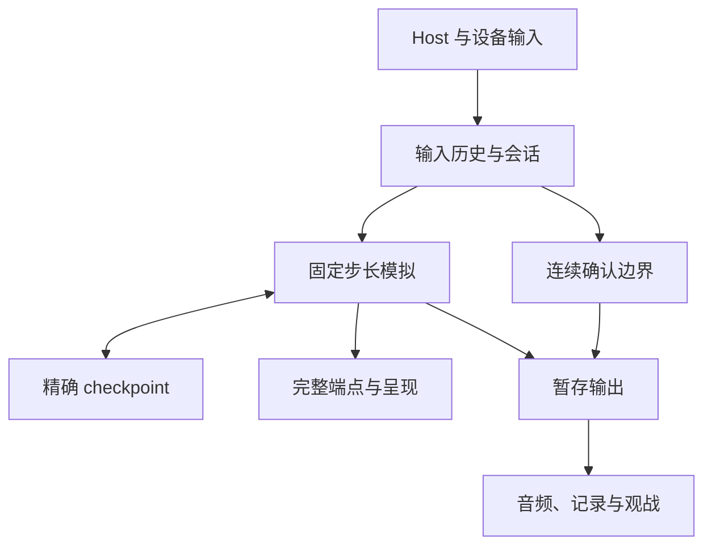
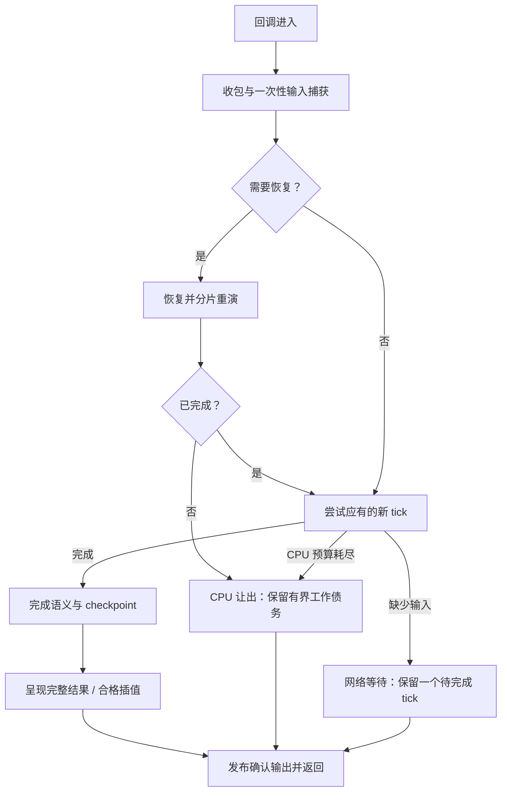

# 多人预测回滚架构：TH09、TH08 的成功经验与 TH10 迁移教训

状态：跨作品预测回滚架构与迁移实践。
更新：2026-10-14。本文以中文记录已实现机制、成功证据、失败尝试和迁移顺序。

## 1. 技术目标与相关文档

目标是让预测回滚真正降低玩家的输入等待，同时保持连续、自然的画面运动。
网络信息暂时不足时可以逐渐降速；突然长时间静止、输入排队和不均匀跳步需要单独解决。
逻辑帧率、显示回调频率和玩家看到的运动连续性必须分别理解，不能用一个 FPS 数字代替。

相关技术文档：

- [Multiplayer](multiplayer.md)：产品身份、房间、传输、输入与确认所有权。
- [Rollback](rollback.md)：精确恢复、性能分解、TH06/TH07 经验与失败记录。
- [Interpolation](interpolation.md)：固定时钟、高刷呈现、字段与生命周期所有权。
- [Replay determinism](replay-determinism.md)：输入、RNG、ECL、Replay 和确定性。
- [Performance and rendering](performance-rendering.md)：主线程、GPU、音频及测量。
- [Adaptation worktrees](adaptation-worktrees.md)：隔离开发与向集成树推广的边界。

## 2. 分层：谁可以改变什么

共享基础设施优先放入 eagler-common；作品适配器负责作品自己的状态和生命周期。
不要为了消除几行胶水代码建立一个不知道作品语义的万能驱动器。

| 层 | 拥有的内容 | 不应拥有的内容 |
| --- | --- | --- |
| Launcher / Host | 房间、资源准备、设置、触控覆盖层、Runtime 生命周期 | 世界推进、碰撞位置、回滚决策 |
| Runtime 输入接收 | 消息资格、物理状态、一次性动作的接纳 | 重演时重新采样设备、直接驱动额外 tick |
| 输入历史 / 会话 | 帧号、已捕获输入、收到的实际输入、预测、ACK、确认 | 可被世界 Restore 倒退的网络时钟 |
| 浏览器传输 / relay | 信令、ICE、实际路由、输入与控制通道、定向转发 | 在中继模拟游戏或用连上房间代替输入健康 |
| 作品模拟 | 固定步长 Update、语义 Draw、RNG/ECL、游戏规则 | 浏览器到达时间或插值位置参与规则判断 |
| checkpoint / journal | 恢复所需的精确状态和明确的 owner 生命周期 | socket、DOM、设备输入源、不可逆输出 |
| 呈现 | 合格的 previous/current 对、临时插值、GPU 提交 | 改写权威碰撞位置或重复推进 ANM 脚本 |
| 确认输出 | 已确认声音、记录、Replay / 观战等作品规定输出 | 发布随后可能被推翻的预测结果 |

图中没有从 checkpoint 指向输入历史的恢复边。
这是刻意的：回滚世界不应抹掉已经收到的输入、已经采样的本地帧或 ACK 进展。

## 3. 三条时间线与前沿

### 3.1 墙钟时间

浏览器事件、网络到达、rAF、音频和用户手势发生在墙钟时间中。
各进程的 performance.now() 属于各自时钟域，不能直接相减。
rAF timestamp、callback 真正进入时间和 native 返回时间也不是同一个观察点。

### 3.2 逻辑时间

游戏仍按每 tick 1/60 秒的语义推进。
降速改变的是一秒墙钟内执行多少个固定 tick，不是把碰撞、计时器和 ECL 的 dt 改大。
恢复会让模拟游标倒退，再重演历史；这些历史 tick 不算新游戏进度。

TH08 的普通游戏和直接 Replay 保持各自原有 cadence。
MP 有自己的 fixed-tick 事务，不能把 MP catch-up 循环套到普通路径上。

### 3.3 呈现时间

显示可以在两个逻辑 tick 之间多次绘制。
呈现必须读取合格的逻辑端点，并使用与游戏调度一致的时间相位。
“又提交了一张画面”不一定表示物体移动了，也不一定表示屏幕已经物理扫描输出。

### 3.4 必须区分的前沿

| 符号 / 名称 | 意义 | 常见误用 |
| --- | --- | --- |
| next | 下一次将模拟的逻辑帧游标 | 回滚时会倒退，不能当单调进度 |
| replayEnd | 恢复前已经到达、现在需要追上的旧前沿 | 不能在 Restore 时丢失 |
| F | 恢复中取 max(next, replayEnd)，非恢复取 next | 无效 replayEnd 不能参与 max；不能拿 capture 次数代替 |
| A | 连续实际远端输入的 exclusive frontier | 不能取收到的最大乱序帧号 |
| B = max(0, F − A) | 尚缺实际输入的信息量 | 不能独自区分网络慢与远端生产慢 |
| confirmed | 连续真实输入已到齐的输入确认前沿 | 不保证纠正或外部提交条件已完成 |
| 可提交输出边界 | 输入已确认、纠正已完成、已模拟且不再被保留 checkpoint 推翻的区间 | 不能只凭 confirmed 播放或保存预测结果 |
| 触控读取前沿 | 供 Host 读取的最后完整本地逻辑位置和控制状态 | 不能读取半恢复的历史位置，也不能使用显示插值位置 |
| 完整显示前沿 | 完整事务结束后的可显示目标，另带身份、帧号和纠正 revision | 不能把最后一个历史 tick 的局部 previous/current 当成所有显示位移 |
| presented | 已实际提交的完整可显示状态 / 插值 | 不能直接当物理 input-to-photon |

性能窗口宜在同一 session / generation 和有效场景边界内，用 F 的首次跨越定义，保留之间所有 callback。
生命周期提前结束恢复时，旧 replayEnd 随之失效；重开与跨场景计数不能直接拼接。
按可倒退的 next 筛选会丢掉中间样本，拼出并不存在的长间隔。

## 4. 一次浏览器回调的状态机

共同目标是让输入与网络尽早得到处理，让恢复有界让出，并及时显示完整结果。
下面描述不变量；具体顺序和返回码由作品适配器负责。

这里的“发布”仍以可提交输出边界为前提；未完成恢复不能泄漏半恢复状态。
例如 TH08 的 Commit 还检查 Correcting / RollbackFrame，并以 LastFrame 和
FirstCheckpoint 限制提交范围。输入 confirmed 前进本身并不具备这些保证。
网络阻塞与 CPU 恢复让出必须区分：前者等待信息，后者仍在偿还已经发生的模拟工作。
图中的债务必须有界；是否保留额外到期 tick 和新增 elapsed，需要按作品明确选择和验证。
不能把“保留一个待完成 tick”扩展为所有恢复分片都必须停表；见 4.4–4.5。

### 4.1 输入应在昂贵恢复之前发出

TH09 已采用：Pump → 检查 Ready → 捕获未捕获前沿 → flush → Restore。
对方因此能在本端恢复时收到新输入，不必再承受“先恢复、后采样”的额外等待。
历史 tick 使用保留输入，不能消费新的 pulse、拖动或 auto-fire 状态。

### 4.2 完成恢复后，不要忘记原本应有的前进

恢复重做的是旧工作，本 callback 原来欠的新增逻辑 tick 仍然欠着。
TH08 当前路径在完整恢复后允许尝试这个 forward，避免恢复持续挤掉新状态。

TH09 的实现并不完全相同：最后一个历史 tick 恰好耗尽预算时可以先 yield，
下一次再继续；不能把两作描述成逐行相同的恢复尾部策略。
它们共同保证一次采样所有权和完整恢复边界。

### 4.3 预算是“开始下一项工作的门槛”

预算检查不能抢占已经开始的原子 tick、Restore 或 Draw。
超过 8 ms / 10 ms 的 callback 不会仅因超过数字就变成调度错误。
真正需要避免的是在已耗尽预算后继续启动大量额外历史工作。

| 位置 | 当前作用 | 不能宣称 |
| --- | --- | --- |
| TH09 历史恢复 8 ms | 在历史 tick 之间决定是否继续 | 每次 callback 必小于 8 ms |
| TH09 外层 10 ms | 完成 tick/render 后停止追加 due tick | 等同 TH08 的高刷插值门槛 |
| TH08 history / new tick 8 ms | 控制追加模拟工作 | 所有成本已被硬限制 |
| TH08 v7 最终 Draw 10 ms | 决定是否开始最后一次只读插值绘制 | Draw 本身一定在 10 ms 内完成 |

### 4.4 等待与相位不能互相吞掉

重试已经到期的 tick 时，不应再等一个新的 1/60 秒信用。
网络等待与 CPU 让出不能仅因“本回调没有新 forward”就使用同一种停表规则。

| 原因 | 保留义务与边界 |
| --- | --- |
| 缺少实际输入，无法前进 | 保留一个已到期的 pending tick；等待期间不累计新的墙钟预测债 |
| CPU 预算使恢复或额外 tick 让出 | 保留有界的未完成工作；额外到期 tick 与新增 elapsed 是否保留必须显式实现，不能无意丢弃 |

TH08 当前将网络等待和恢复分片都映射到一个 pending tick，期间不累计新 elapsed；
只有普通 CPU defer 退还尚未执行的到期 tick。这是 TH08 当前已采用的策略，不是跨作品要求。
TH10 r2 照搬后出现了下面的 4× 退化，因此不能凭 TH08 的体验认可省掉新作对照。

完成 callback 的小数余量需要保留。
如果“刚好完成但耗时偏高”也每次清相位，恢复会人为降低正常推进率。
归还 tick 不得重复记账，也不改变固定 dt、输入捕获所有权或真实预测前沿。

### 4.5 TH10 迁移实证：CPU 恢复被误当成网络等待

TH10 隔离树为 `../../../th10-rollback-smoothness`。
r2 在独立 headed Chrome、实际本地 RTC、应用层发送注入单向 50±5 ms（非测得 RTT）、双方 CPU 4×、墙钟触控 120 Hz 下，
两端逻辑推进从 baseline 的 59.723/59.691 Hz 降到 51.813/51.956 Hz，正确性与前沿断言仍通过。
这是已保留的退化样本，不能用 PASS 或更短的部分 callback 宣称性能改善。

源码链是 `ApplicationHost` 回滚分支中的所有 `!advanced` → `recovering()` → `blocked(true)`。
`PendingFrameSchedule::advance()` 在 retry 时只返回 1，忽略新 elapsed；
若第一次让出时 `offered-completed>1`，又只保留一个 pending，并跳过尾部 defer，额外到期 tick 也丢失。
这两条丢时钟路径已由源码确认；它们各自解释了多少降幅，不能仅凭回调结束时间近似统计断言。

r3 已仅在 TH10 区分两类等待：仍在 `Correcting()` 时清 retry，归还 `offered-completed`，
后续回调重新累计有界的新 elapsed；真正缺输入时继续保留一个 network pending。
从 network pending 转入 CPU 恢复不会追补过去的网络等待时间；本次归还后不能再执行尾部 defer。
8 ms 工作门槛、完整恢复才能呈现、一次性输入捕获和缺口渐进制动均保留。
r3 的针对性原生 pacing 测试通过，但同条件正式包 RTC 复测仍未恢复到 baseline：
两端逻辑推进为 54.141/54.276 Hz，P0 Present 仅 50.702 Hz，新增逻辑帧间隔 p99 为 62.9 ms。
因此 r2、r3 都不能推广；时间记账正确只是必要条件，恢复分片与最终呈现仍需整场性能验证。
该修复的适用范围为 TH10，TH08 / TH09 保持各自已验证的实现。

原始 r2 证据：`../../../th10-rollback-smoothness/artifacts/rollback-smoothness/candidate-r2/rtc-touch120-cpu4-delay50-jitter5-headed-rtc15s.json`。
原始 r3 证据：`../../../th10-rollback-smoothness/artifacts/rollback-smoothness/candidate-r3/rtc-touch120-cpu4-delay50-jitter5-headed-rtc15s.json`。

### 4.6 恢复分片太短，也可能增加卡顿

分片为浏览器让出执行机会，也增加了下一次收包重新触发 Restore 的机会。
“每片至少执行一个完整历史 tick”并不保证恢复游标净前进；刚重演过的预测前缀仍可能被新的实际输入推翻。
这类重复是合法纠正，不能通过忽略晚输入、提前呈现未恢复世界或放宽确认边界来消除。

TH10 r3 的稳定 4× P0 窗口中，329 个未呈现 callback 全部仍在 Correcting，
其中 149 次恰好只剩一个历史 tick；其余 720 个已完成 callback 都已呈现。
至少 30 对连续恢复片在执行过历史事务后游标仍未增加，证明存在前缀重启。
其中一段在缺口 4→2、scale 始终 1 的情况下反复停在恢复尾部，完整 callback 的结束间隔达到 67.5 ms。
这一段的画面停留不能归因于网络渐进制动，也不能归因于“恢复完整后被最后 Draw 门拒绝”。

因此迁移预算时，要同时检查单 callback 尾部、恢复完成间隔和整场净推进率。
若尝试给“只差最后一个历史 tick”的恢复增加完成机会，仍应保留同一个墙钟起点、明确的时间与数量准入门，
并完成原事务后才返回。此策略在 TH10 尚属实验；不要把待测阈值写成所有作品通用配置。
r6 已实现普通历史事务 8 ms、只剩最后一笔历史事务时 12 ms 的准入门，
保留最多 6 笔与至少完成第一笔事务的规则；原生边界测试通过。
12 ms 是开始下一笔完整事务的门槛，不是 callback 时长保证。
r6 正式包真实 rAF / RTC 的 1× 双端逻辑推进为 59.839/59.897 Hz，完整状态和音频一致；
但 P0 的 cadence 门仍未通过，零 recovery yield 也不能证明尾部宽限没有被使用。
4× 的 900 帧运行虽通过状态与音频校验，逻辑推进仅 7.534/7.602 Hz，
最长推进间隔 834.3/780.9 ms，因此性能严重不合格，不能推广。
随后用同一个独立 relay 的原正式包作 480 帧对照；在共同的 179→527 连续窗内，
原版为 19.127/19.630 Hz，r6 为 8.975/9.154 Hz，双方都未达到流畅目标。
这是两次顺序单样本；不能将全部差异归因于代码，也不能用原版异常替候选免责。
原版 P1 在整轮 rollback/resim 计数均为 0 时仍出现 185.6 ms native callback，
说明普通推进与外部调度的成本也必须继续隔离。先前原版约 59.7 Hz 的稳定证据仍保留。
完整样本、身份与窗口边界见 TH10 工作报告及
`../../../th10-rollback-smoothness/artifacts/rollback-smoothness/r6-baseline-matched-window.json`。
原始 r3 证据与零基行号定位见 TH10 工作报告及上面的 r3 JSON。

## 5. 输入捕获、发送和触控

### 5.1 一帧采样一次

输入采样、传输重发、预测和重演是四件事。
一个逻辑帧已经捕获后，即使重发十次、回滚八帧，也不能再次读取 DOM 或设备。
D0 表示没有额外排队的本地输入帧，不表示零预测、零回滚或零物理延迟。

按钮也要按语义分类。
TH09 可保持射击 / 蓄力、低速和方向；Bomb、菜单动作需要实际输入。
不能为减少纠正而无条件预测所有按键，也不能凭空制造 release edge。

### 5.2 同回调旧尾与新尾合并

TH09 观察到 Pump 发旧输入尾部，紧接着本地 capture 又发完整新尾部。
common 512353c 仅在明确即将连续捕获时，暂缓 ordinary input。
暂缓发生在 sequence 分配与编码之前，随后发送包含新帧的完整尾部。

必须保留以下出口：

- due repair、控制、退休及保守背压路径按原合同处理。
- capture 成功、拒绝、Pump 失败或未 Ready 都完成旧发送义务。
- Restore、Prepare、yield 和提前 return 前 flush。
- 跳跃安排输入的调用者，在可能覆盖历史环槽之前先 flush。
- 独立 timer pump 不应因“可能很快有输入”无限等待。

实测重复对 P2 519→0、P1 321→1，wire tape 和确认状态一致。
这是发送形状改善，不能换算成对应比例的 CPU 提速。

WebRTC 快速输入与可靠控制 / 修复有各自合同，WebSocket fallback 也要实测。
有界可靠修复可以补快速通道缺帧，不能修复所有通道同时中断。
actual direct、TURN 与 relay 以实际选中路由为准，不能由启动参数推断。
独立 relay 减少部分共享执行环影响，但仍有自己的队列、事件循环和发送开销。

### 5.3 绝对目标与一次性位移不能混用

TH09 的 DirectTouch 是持有的绝对场地目标。
在被模拟的那一帧，所有 peer 根据各自一致的权威位置计算移动。
若发送端按发送时的世界位置预先算速度，接收端稍后应用会出现绕手指移动等错误。

TH08 的 fresh delta 是新的位移量，必须只转移一次给逻辑输入所有者。
没有新位移时预测零新增 delta；已经接收但尚未应用的 remainder 由同步模拟负责。
不能照搬 TH09 的“保持绝对目标”，变成每个预测 tick 重复施加一次拖动。

改输入表示会影响编码、Replay、状态哈希、reset 和回滚库存。
它不是只换一个 predictor 分支的局部性能修改。

### 5.4 managed 触控接收不能等待资源队列

两作都发现了输入入口与异步资源 / 文件系统命令共享队列的问题。
键盘已走快路，并不证明触控也及时。
触控移动、控制和取消应在有效消息已派发时及时提交 native。

快路仍必须验证 source、origin、protocol、game、epoch 和当前 document owner。
initialized、core 存在、launched、异步 launch settled 是不同状态。
同一个 WindowProxy 和 epoch 不能单独证明 iframe 仍是原 document。

不要强制 document.hasFocus()：合法父层 overlay 可以拥有焦点。
隐藏、关闭、退休、切换控制策略和观战时应按合同拒绝或中和输入。
快路不在 handler 里主动 tick、draw 或 pump，也无法抢占尚未派发的 message task。

### 5.5 动作 serial 与生命周期

source serial 记录已见过的发送端动作，mapped serial 表示真正获准提交的动作。
通过消息来源门禁、但当前生命周期不接纳的输入仍消费 source 基线，不能恢复后补发旧动作。
未通过 source / origin / protocol 等入口验证的消息不得影响这些基线。
中和输入不应生成新动作；cancel 保留作品原有 fire toggle 和 pulse 语义。

TH08 新接收器 11/11 通过，旧源码两个资源 / FS 队列用例实际失败。
TH09 真实 listener 对照中，旧版 57 个目标有 40 个失败，候选达成 57/57。
这些证明接收顺序、资格和 ACK；不等于已经测得物理触控延迟。

### 5.6 触控 getter 也需要完整逻辑前沿

“每帧只捕获一次”还不够。触控控制器常先读取自机位置，再把墙钟手势转成输入。
TH10 的世界在分片恢复中会暂时停在历史位置；此时直接读取 native Player，
即使后面的输入捕获没有重复，也会把历史坐标用于新的手势，产生回拉或错误锚点。

TH10 用独立的 [TouchInputFrontier][th10-touch] 保存原有 8 word 控制视图。
它在第一次 Restore 前保留完整状态，并在 Update、semantic Draw、封帧均完成后发布；
Correcting、open frame 和 resimulating 期间只返回同一身份的完整缓存，不调用历史世界 getter。
首个 tick 之前保留原有冷启动读取，但不冒称已经完成了逻辑帧。
该缓存属于 Host 输入视图，明确排除在 checkpoint 和 canonical owner 之外。
具体接线见 [ApplicationExports][th10-exports] 与 [Application][th10-app]。

身份至少覆盖 world、session、generation、座位、人数和角色；不可用、重开或身份变更时旧视图失效。
[GameHost][th10-game-host] 按 epoch 重新建立手势锚点，同时保留 Launcher 已接纳动作的 serial 合同。
这条输入视图仍来自本地权威逻辑位置；远端显示桥、相机插值和屏幕坐标不能反向进入它。
需要分别测试普通推进、跨回调恢复、首帧、取消和换座，不能只测稳定运行时 getter 有值。

## 6. 信息不足时渐进降速

TH09 的已采用规则先处理到达输入，再使用连续输入缺口 B。
目标是让稳定预测留有空间，并在接近历史上限时平缓减速。

目标间隔倍率为：target = 1 + clamp((B − 4) / 3, 0, 1)。

| B | 目标间隔倍率 | 说明 |
| ---: | ---: | --- |
| 0–4 | 1 | 固定免制动区间 |
| 5 | 1⅓ | 开始减慢墙钟推进 |
| 6 | 1⅔ | 更接近预测边界 |
| ≥7 | 2 | 最多约两倍间隔，仍有有限预测上限 |

倍率每 50 ms 最多增加 1，每 150 ms 最多减少 1。
已有 phase 校正在约 0.98–1.02 内微调；制动生效时按源码取较大倍率。
清理、未 Ready、非对应模式或不期待输入时按合同复位。

### 6.1 不要把固定死区写成自适应 RTT

TH09 参考版本使用固定 4 帧免制动区间，没有自动学习稳定预测深度。
50 ms RTT 与单向 50 ms 不同。若两个方向各增加 50 ms 发送延迟，额外 RTT 约为 100 ms；
只给一个方向增加 50 ms，则额外 RTT 约为 50 ms。实际 RTT 还包含原有网络和排程延迟。
60 Hz 下的预测需要量还受采样相位、传输和输入调度影响，不能仅由一个“50 ms”断言必为 2 帧。

当前规则不把本地 callback 耗时作为降速目标。
但远端 CPU 慢、浏览器迟派发或输入生产中断，也会造成 B 增大。
因此“依据输入不足”不能进一步等同于“原因已证明只在物理网络”。

### 6.2 只缩放新增时间

TH08 NetworkFrameSchedule 归一新进入的 elapsed，小数 debt 不重复缩放。
插值 alpha 使用同一条调度时钟下的剩余逻辑相位。
降速以后仍按固定墙钟 16.67 ms 计算另一条 alpha，可能使端点到达与插值脱节。

恢复有效时 F 使用 max(next, replayEnd)，非恢复时使用 next，避免游标倒退产生虚假预测余量。
A 必须连续，避免乱序晚包掩盖前面的洞。
收到数据后先 Pump，再判断缺口，避免把已经排队的数据当成尚未到达。

### 6.3 输入完全停止时有自然边界

预测历史有限，不能在完全没有实际输入时无限推进。
对方正常暂停、隐藏或停止产出后，本端最终等待是自然现象。
需要追查的是正常游玩中为何突然不再生产输入，而非强迫另一端永远单方面运行。

## 7. 语义 Draw 与高刷呈现

TH08 MP 的每个 fixed tick 包含完整 Update、semantic Draw 和四类 journal End。
省掉其中有状态语义的 Draw，可能改变游戏、动画、临时文本或下一 tick 的起点。
额外高刷 Draw 是另一个经过资格判断的只读呈现路径。

TH09 历史 tick 也保留语义 Draw，只省已证明可以省的 GPU submission 和部分纯几何。
TH09 参考版本没有 TH08 那套独立的无新 tick 高刷插值路径。
因此不能把 TH09 的外层循环形状原样视作 TH08 的高刷方案。

TH10 再次证明，每次成功完成的联机逻辑帧模拟都必须执行一次 authored Draw。
[ApplicationFrames][th10-frames] 将 MP frame skip 固定为 0；正常 Update 后保留 open frame，
到 semantic Draw 结束才封帧并 MarkSimulated。历史恢复同样走
“输入提交 → Update → semantic Draw → EndFrame → MarkSimulated”。
这里的“一次”按每次模拟计数：同一个帧号回滚重做时必须再执行，等待网络而没有新 tick 时则不执行。
只读高刷 Draw 是另一条呈现路径，不能额外消费 ANM、visual RNG 或一次性队列。
这里的只读指不推进或污染权威游戏状态；独立展示缓存可以更新，临时绘制写入仍须按 7.3 恢复。
[Application::multiplayer_resimulate_draw][th10-app] 仍调用 draw_all，只抑制已经证明可省的历史精灵输出；
有待处理的原作像素捕获请求时保留完整输出。预算门位于完整事务之间，不能把 Draw 的写入留到封帧之后。

### 7.1 TH08 的“FPS 不掉却顿挫”

v6 的一条实际记录中，正常相位约 0.13603，却提交了语义终点 alpha=1。
结合回调耗时和源码分支，该记录与预算耗尽后提前提交端点的路径一致。
探针未直接记录预算分支标志，因此这里是由运动记录和源码共同支持的判断。
随后相位约 0.41053、0.68053、0.97101 的三次新 Draw 仍显示同一子弹位置。
这些回调并非还在恢复；显示提交继续增加，运动却先跳到终点、再保持不动。

显示过终点后，不能继续在旧起终点中间插值，否则会倒退。
该例如果直接去掉 presentation gate，会倒退约 0.556 像素。
所以修复方向不是删除 gate，而是减少不必要的提前终点呈现。

### 7.2 v7 给最终插值留出短窗口

TH08 v7 保持 history / new tick 的 8 ms 预算，
将最后一次只读插值 Draw 的开始门槛设为 10 ms。
完整恢复、语义 Draw、End 顺序和已呈现终点后的防倒退保护仍保留。

两端对应 hold 片段从 60/55 降到 12/9；
按稳定对象观察时间归一，从每秒 4.406/4.024 降到 0.951/0.713。
逻辑推进约 45.58→45.66 Hz，改善并非靠进一步降速得到。

这只支持该类连续性信号明显减少，不是“整体性能提升 80%”。
观察对象、合格片段和两轮实际触控轨迹有范围限制，原始记录继续保留。

### 7.3 最终像素与对象生命周期

TH09 参考构建移除了最终 sprite 顶点的整数取整，保留原有 −0.5 像素栅格偏移。
前面用了浮点输入和插值，最后再取整，仍会抹掉亚像素连续性。
不能把“保留小数”误写成把所有 half-pixel convention 都删掉。

previous/current 必须按 generation、owner、脚本和可见性等资格关联。
对象复用、瞬移、冻结、重生、切脚本和资源替换时应按作品规则 snap 或重建端点。
插值位置不能参与碰撞、收点、isOnscreen、目标选择或状态机判断。

重复 Draw 的临时写入应恢复为语义 tick 完成后的 authored current 状态。
文本与临时绘制队列不能被第一张高刷画面提前消耗，也不能每次重复生产。
“高刷能玩”不自动满足完整 Presentation Lab 的 owner 覆盖与纯度准入。

### 7.4 绝对触控的历史端点可能相同，仍需呈现完整纠正位移

TH10 的绝对触控预测会保持最后已知目标。远端在一段预测历史中已经到达这个目标以后，
最后一个历史 tick 的逻辑 previous/current 可以合法地相同。
新的实际目标随后触发纠正；若高刷只看这个局部端点对，完整世界已发生变化，远端本体却没有可插值的位移。
已确认的例子是远端逻辑端点始终相同而本地移动正常，不能靠增加 Present 次数修好，
也不能据此认定保持绝对目标的输入语义错误。

TH10 的最小候选是 [RemotePlayerPresentation][th10-remote]：
把上一个完整预测前沿的目标连接到本次最终完整前沿，供远端本体的临时显示副本使用。
它不修改 Pilot.presentation、native Player、输入编码、预测规则、碰撞或本地触控来源。
[WorldPlayerMultiplayer][th10-world-player] 只在高刷只读路径选用合格显示对，并沿用现有 world_alpha；
本地玩家保持原路径，不能据此宣称 options、shots 等其他对象也已经取得同样连续性。

这个桥有四个关键边界：

- 第一次 Restore 前才能冻结完整目标。嵌套纠正、open frame 和历史重演不得读取并发布历史身份或坐标。
- 在 Application::step 最终完整边界发布一次，不在 EndCorrection 和随后 forward 之间各发布一次。
  相同帧号与 revision 的无操作发布不能把端点折叠；同回调多个 forward 仍须服从现有呈现时钟。
- 端点要绑定 world、session、generation、stage、screen、角色、座位、人数，以及玩家地址、死亡次数和状态。
  原生当前目标还须与缓存终点逐位相同；重生、复用、跳变、停止或失效时 snap / 清理。
- 没有新增 forward 的完整恢复按原调度规则 snap；若终点尚未真正显示，可保留冻结锚点供后续前进。
  只有真实 alpha=1 或 authored 终点 Present 成功后才 consume，防止下一回调用较小 alpha 倒退。
  调用过 Draw、排队过 surface 或仅执行过观察器，均不能代替这个消费确认。

缓存只保存固定纯值，显式排除在 [World 的逐项捕获 owner][th10-world] 和 canonical 之外。
实际消费由 [ApplicationHost][th10-app-host] 的 GPU 提交确认进入 Application::presentation_frame，
不是 render_only 函数提前宣布已显示。

观察记录也要保留原始逻辑端点，另用显式标签说明采用了完整显示前沿。
当前 TH10 保持 352 word 主记录不变：CompletedFrontierEndpoints=256 才启用保留槽中的 RFP1 扩展；
Valid / Snap / Consumed 分别是 1 / 2 / 4，记录源帧、目标帧、revision 与身份。
不能悄悄把 raw previous/current 改成更好看的显示对，造成“逻辑已连续”的假证据。
已归档运行证明该桥进入实际远端几何路径，最终像素与整作验收范围仍见 13.3。

### 7.5 原作绘制的最后一帧，不能靠事后稳定状态重建

保留 semantic Draw 与保留它所产生的 GPU 输出是两个需要分别证明的合同。
前者可能写 ANM、Stage、visual RNG 与队列；后者还可能成为原作像素捕获、截图或一次性过渡的来源。
仅证明“高刷 Draw 能再画一次”，不足以省掉这一次 authored GPU 工作：
Draw 结束时权威状态已经改变，从后置状态重画未必还原刚刚产生的图像。
r10h 保留 [完整 authored Draw 和提交][th10-authored-frames-r10h]，只在合格时允许后续一次只读末呈现。

真实反例来自 [StageRenderer::draw_foreground][th10-stage-renderer-r10h]：
fade 的 current / fractional 为 1、rate 为 1 时，本次先绘制，末尾再 advance(-1)。
draw_flags=1 会保持可见、清除 fade；draw_flags=3 会变成 9，下一次 Draw 直接跳过。
只看 Draw 后的 fade=0，会把前一种最后帧误判为稳定画面。
[Timer::advance][th10-timer-r10h] 又会把 fractional 向零截成 current：
rate=0.5、起点为 1 也会得到 fractional=0.5 / current=0，并结束 fade；
真正的半速中间帧对照必须从 2 开始，得到 1.5 / 1。不能用“仍有半帧小数”推断尚未触发结束分支。
Timer.previous 还可能在 fade 结束后一直保留 1；应保留本次前置否决，不能永久用 previous>0 禁用呈现。

因此资格要记录本次事务全过程遇到的边界，并以 OR 保留否决位。
r10h 在 step 开始、authored Draw 前及 Presentation.submit 前后观察当前 / 前一 Stage、
场景身份、捕获、截图、暂停与资源状态。尤其是 Draw 新产生的 capture / screenshot，
必须在 submit 消费或清除请求之前留痕；只在 step 前与 submit 后检查仍可能漏掉。
完整的同帧 finalize / submit 才能清除“尚未完成”位，不能顺带清掉已经观察到的 fade 或捕获否决。
缺少 Draw、重复 Draw、历史重演、失败或过渡都不能继承上一帧的资格。[冻结接线][th10-authored-boundary-r10h]

这些位属于 [Application 的宿主成员][th10-authored-owner-r10h]，不是游戏状态。
它们只决定是否追加一次只读呈现，不进入 GameState、journal、canonical 或网络协议，也不改变模拟与音频欠账。
身份记录保留地址整数和 generation 等值，后续比较不解引用已经退休的旧 Stage。
共享的是这种所有权和前置留痕规则，不是把 TH10 的字段表直接复制到下一作。

[真实组件收据][th10-stage-unit-r10h] 与 [逐场输出][th10-stage-output-r10h] 记录了 WASI32 / O2 的 ordinary、
multiplayer 各 6 场景、1,446 检查，包括 fade=0 正控、最后帧的两个 post-only 反例、
隐藏分支和两种半速边界。测试调用真实 StageRenderer、Timer、Camera、GraphicsMath、AnmRenderer，
并记录设备边界调用；它不代证完整 Application 生命周期、实际 GPU 像素、音频或浏览器性能。

## 8. 日志、资源与确认副作用

### 8.1 优先减少重复工作和登记次数

先分开普通推进、捕获、恢复、重演倍数、几何、提交、音频和诊断成本。
稀疏日志不是只追求字节最少：大量小块索引、分配、跨边界复制也可能昂贵。
容量应在 rewind、confirm 和环槽复用间合理保留，避免刚释放又立即申请。

TH09 使用完整 AnmVm 的固定身份分页首次写入。
wasm32 VM 为 676 B，每页 64 个、43,264 B；整槽和单 part 共用首次写入位图。
物理 record 保留分配容量，但每 checkpoint 的有效位图、顺序和计数独立。

Enemy 固定池有 slot 首写索引，陌生 owner 保留原指针表 fallback。
容器、多态对象、unique_ptr 和资源生命期不能像普通 POD 一样跨 checkpoint 覆盖。
Seal、Save、Restore 的 observer 解除规则必须显式维护。

### 8.2 TH08 的块数与字节取舍

TH08 ScreenEffects 的固定槽捕获登记由 1,024 块变成 2 块。
v6 这项批量方案相对 v5 多保存 1,792 B，换取减少登记和重复遍历。
不能宣传为这一个改动同时减少了所有字节。

另一固定世界场景的日志峰值从 692,382 B 降到 605,390 B，
减少 86,992 B，约 12.56%；这是指定场景的日志指标，不是整机性能百分比。
块数、有效保存字节、保留容量和真实 CPU 时间应分别报告。

### 8.3 精确数学快路与缓存

缓存必须覆盖真实输入、舍入模式、精度和生命周期，并为异常值保留原路径。
浮点异常标志也是可观察状态：命中须恢复原调用的输出与后置 flags。
输入输出部分重叠且别名形态不在缓存合同内时，应走原路径，不能仅凭相同初始字节复用。
不能为速度启用改变游戏结果的重结合、fast-math 或容差化 canonical 检查。
TH08 camera、Background 数值、projection 分别有 24/11,856、12/310,860、
24/43,657 的模式 / 检查记录；这些是正确性证据，不是 FPS 改善量。

### 8.4 确认输出与资源边界

音频、记录和观战输出应按作品合同暂存，确认后按顺序发布一次。
回滚推翻的帧丢弃旧命令，重演重新生成；不能重复播放 Bomb 或触发外部保存。
音频 pump 属于持续服务工作，不能被无界恢复长期饿死。

菜单动画可以参与回滚；真正释放或替换世界资源的动作需要确认与寿命屏障。
TH09 对 speculative menu resource action 有明确拒绝路径。
资源写、读回、释放、纹理修改和 renderer flush 屏障不能在批处理时漏掉。

### 8.5 第一帧之前的动画图也必须一致

TH10 迁移时，定向放大一端开场轮询次数，能在首次历史回滚之前造成失步。
原 r4 在双方已完成并确认第 59 帧时，GUI 的三个 ANM 句柄相差 170，
visual RNG 调用次数为 16 / 0，Stage 与 StageVM 字节相同；
投影缓存此时两端均为零命中。关闭缓存、保留对象布局的对照也复现了分歧。
因此“局部缓存数值通过，但整场 canonical 不同”需要先按阶段定位，不能直接归因缓存命中。

开场资源等待使用真实两秒，而等待期间原本仍允许普通 ANM / Common tick。
不同加载或轮询节奏会留下不同的动画分配历史、句柄和活 VM；
进入世界时只重置 RNG 的 seed / calls，无法同时恢复这些 owner，
留下的动画还可能在 seed 重置后继续消费视觉随机数。

TH10 的最小修复在预配置的新会话中保留两次必要开场 Draw，
继续服务资源加载、真实等待和网络，但在等待期间冻结额外语义 tick。
定向复现中，修复前启动轮询为 410 / 71 次并失步；
r5 修复后仍为 354 / 61 次，但第 59 帧完整 canonical 相同，ANM 游标均为 31，
visual RNG 调用均为 0，且尚未发生回滚。随后第 315 帧最终共同确认的 canonical / 音频也一致。
这验证了该启动分歧的修复，不是整作性能或所有生命周期的验收。
此门依赖产品已验证的“configure 在首 tick 之前”生命周期，
不等价于任意晚配置后都能重建整个初始世界。

验收至少保留一次共同确认的开场 canonical 与最终 canonical，
并记录首次回滚发生位置；终场单一 hash 只能发现差异，不能说明它在哪里出生。
定向原始证据与后续状态见
`../../../th10-rollback-smoothness/docs/multiplayer-smoothness-20261012.zh-CN.md`。

### 8.6 新局校准仍可能收到旧局包

RetireRun 成功不表示旧局消息已经从网络中消失。上一局终态 ACK 及其重传、
输入尾包、会话控制和阶段报告，仍可能在较快一端进入下一局校准后到达。
终态 ACK 缓存和退休 pump 应继续服务较慢对端，不能为避免报错直接清掉。

TH10 向下一局 AdonisConnection 显式提供已成功退役的旧会话配置。
校准提交前，仅完整解码且符合该旧会话、人数与角色要求的 Input、Session 和 ADP 包
可以被忽略，不进入新局输入核心。陌生会话和当前会话提前到达的 gameplay
继续保留严格失败行为；Prepare 默认不启用此例外，Clear 清除旧标识。
旧 ADS 校准包遵循 AdonisStartup 原有规则，本次没有扩大或改写其验证范围。

common `7766625` 已通过原生对照：同一份 44 字节旧 ACK 在原头文件上令校准失败，
显式提供 retired 配置后被正常忽略，既有 Adonis startup 套件也通过。
随后在两独立桌面进程、实际本地 RTC、v4 纯 Delay / D1 的原始 SDL 菜单路径中，
观察到旧局第 154 帧的终态 ACK 缓存字节在新局校准期间到达；
接收函数正常返回，新局完成 129 次 probe / 120 次 reply，并继续到共同确认边界。
这个生命周期观察已完成，整条测试仍因新局 scene / chain 的原始 canonical 不同而失败，
不能作为完整正确性或 rAF 性能验收。其余门禁、原始 owner 字节与失败报告均保留。
已移除的自动 wipe Retry 与仍可达的手动 Restart 应分别记录，
过时的自动 Retry 夹具不能代替实际菜单路径验证。

### 8.7 inactive 首写、稳定地址与物理退休是三份合同

稀疏初始捕获只保存当时 active 的槽，因此必须补上“检查点开始时 inactive、帧内后来分配或复用”的首写屏障。
旧槽可能残留链表指针、回调字段和 padding；只恢复 occupied，不恢复初始化前的完整槽字节，不满足严格撤销。
屏障必须发生在第一次 payload 写入、memset 或构造之前，不能先 allocate(..., true) 清零，再 Touch 返回指针。
占用位、cursor 和链表引用本身也必须在同一事务中可恢复。

TH10 的 [RollbackPoolCapture][th10-pool-capture] 按完整 Storage 对齐步长捕获 active 连段，
并由 TouchSlot 为未捕获的整槽保存前像。这个规则不等同于只保存 sizeof(payload)，也不允许漏掉尾部 padding。
[AnmManager][th10-anm-manager] 的 preserve_animation_slot 和 [WorldHints][th10-hints] 初始化前的完整槽 Touch 是具体接线例子。
池被 BeginFrame 枚举、通用随机 oracle 通过，都不能自动证明每条生产 create / reuse / clear / callback 入口已接屏障。

TH10 后续逐条检查确实发现了 callback、ANM overflow、几何、Dialogue、ScreenEffect、ECL、Enemy、Laser 八类池的上述遗漏。
其中几何有两条生产分配入口，因此共九个入口；其余五条入口保持原整块清零尺寸和原来的无效尺寸、满池返回语义。
callback 补丁通过实际 Callbacks::allocate_entry / UpdateChain 调用，将保存放在原清零之前。
[O2 收据][th10-callback-o2] 与 [UBSan 收据][th10-callback-ubsan] 各完成 16 个用例、141 项检查：
26 次整个 Pool 比较全部相同，4 种容量不足事务被拒绝；固定旧源码则出现 18 次完整池不一致，
6 次缺少清零前观察和 4 次未拒绝的超预算事务，既有 active 槽等正对照继续通过。
该 unit 使用 receiver fixture 连接真实 pool capture / common journal，未执行真实 World / Application 提交边界；
不能把它写成完整场景或性能通过。
后续 ANM overflow 的 [O2][th10-anm-overflow-o2] / [UBSan][th10-anm-overflow-ubsan] 各通过 16 用例、288 项检查，
20 次完整 Pool 与 20 次完整 manager 比较全部一致；仅还原旧 overflow 分配体的对照有 14 次完整池不一致。
几何的 [O2][th10-geometry-o2] / [UBSan][th10-geometry-ubsan] 各通过 14 用例、144 项检查，
10 次完整 Pool 与 10 次 VM / RNG 等 owner 比较一致，旧几何分配体对照有 6 次完整池不一致。
两类专项均执行真实 AnimationEngine 构造 / 析构及相应生产入口，但 RollbackState::Touch 是明确的测试委托，
仍未覆盖真实 World 的分发与 Application::MarkSimulated；它们的生产源码字节与 r10f 冻结清单一致。
预算失败均由 journal 锁存并拒绝 EndFrame；已分配指针仍可能非空且初始化仍可能写入，不能表述为“当场无写入”。
几何分配尤其容易写错：原清零覆盖整块 64 KiB，屏障必须覆盖同一整块，不能仅保存调用方请求的少数字节。

[RollbackPool][th10-pool] 的内嵌数组保证地址稳定，release 只改变占用状态。
有完整首写、分配元数据及引用恢复时，固定槽可以在回滚窗口内逻辑复用；
不需要把所有槽都延迟到确认后才允许再用。相反，vector、map、unique_ptr、多态对象和绑定引用的服务对象
不能通过复制容器头恢复所有权，析构、重分配与外部指针必须另有事务设计。

资源图的物理释放是另一件事。[Backgrounds][th10-backgrounds] 先成功登记非 journal 退休记录，
再解除回调并完成逻辑删除；保留原资源，待所有可能恢复出该引用的检查点退出后才释放。
恢复使资源重新成为 current / previous 时撤销该退休；容量不足必须明确失败，不能偷偷提前 free。
退休队列管理物理寿命，本身不随世界 journal 回滚。

当前 TH10 在已模拟且确认的逐帧边界先 DiscardBefore，再 collect_retired。
这是基于当前逐帧 checkpoint 的正确顺序，不能简化成“confirmed 前进即可释放”。
[common Journal][th10-journal] 支持按 endFrame 保留跨帧记录；
将来若启用 checkpoint span / extendPrevious，必须重新计算真实最早可恢复的起点，再决定退休资格。
输入确认前沿、记录的结束帧和资源最后仍可被恢复的帧不是同一个量。

## 9. 两作成功过程与没有采用的方向

| 阶段 / 机制 | 已证明的作用 | 应保留的限制 |
| --- | --- | --- |
| TH09 完成状态及时呈现 | 修复“未走到最后 due tick 就预算退出”的呈现饥饿 | 早期正式 4× 仍约 31 Hz，不能改写为当时已达标 |
| TH09 renderer / 存储复用 | 固定完整渲染带减少提交、buffer replacement 和临时分配 | 不等于整机 CPU 按相同比例下降 |
| TH09 提前采样与缺口制动 | 输入早发、有限余量内逐渐降速 | 固定死区，未区分输入缺口的全部来源 |
| TH09 VM / Enemy 首写 | 固定 owner 去重、页面复用、精确恢复 | 单项整场速度贡献未全部隔离 |
| TH09 held target、managed、D0、亚像素 | 输入语义与最后呈现边界组成参考版本 | 不把后来独立树优化倒算进来 |
| TH08 完整恢复和 pending tick | 不以半恢复状态呈现，避免恢复吞掉原应有前进 | 普通游戏 / Replay cadence 仍独立 |
| TH08 日志与精确快路 | 降低已识别重复成本，正确性门禁有证据 | world 八场景仍限 stable-stage Update / semantic Draw |
| TH08 managed 与 v7 插值窗口 | 接收队列问题复现修复；hold 信号显著减少 | 正式端间成本差异尚未解释 |

以下尝试没有因此成为默认方案：

- 为压低重演次数增加本地 D，或无条件缩小预测窗：会增加控制等待或更早硬停。
- 整个跳过 Draw、仅画一个预测自机：可能破坏语义或让可见位置脱离碰撞权威。
- 照搬 TH07 checkpoint span 3：其他作品的资源和输出保留边界仍需证明。
- 通用 TouchMany / bulk 原型、紧凑打包、O3/LTO：正确或字节少也未必更快。
- TH09 Audio SIMD：逐位组件可通过，实际混音存在更慢结果；参考版本关闭。
- TH09 提前制动实验 C：保留约 31 Hz 的严重不利样本，未采用。
- TH09 GPU 单开关：A 坏→B 好→A 也好，未建立可逆因果，未作为修复。
- 直接删 TH08 presentation gate：会让已经显示的端点向后退。
- 在正式包混入诊断扫描：TH09 曾发现 Release 未定义 NDEBUG，需显式 DEV 隔离。

## 10. 如何测量，才能发现真正的坑

### 10.1 性能、正确性和体验分别成立

| 证据 | 可以证明 | 不能外推 |
| --- | --- | --- |
| 源码 / 合同检查 | 某条路径及所有权设计存在 | 实际游戏已进入该路径 |
| 精确组件 oracle | 指定状态、数值或接收顺序正确 | 全世界、全部关卡正确 |
| 三世界 / rollback 对照 | 指定输入与覆盖中的恢复一致 | 实时网络和呈现一定流畅 |
| 正式浏览器运行 | 实际路由、构建和该场景的推进 / 间隔 | 所有设备或物理显示时延 |
| 对象连续性分析 | 合格身份窗口内的保持、跳步、倒退 | 所有视觉层的主观质量 |
| 体验验收记录 | 已记录的实际游玩体验 | 未绑定的设备、构建哈希和未覆盖的网络条件 |

“PASS”通常只表示运行结束且指定门禁通过。
应同时报告合格覆盖、异常、未捕获输入、结束边界和清理结果。

原始字节比较还依赖布局前提。TH10 手动重开诊断中，Hints 的 pending / retained 列表
共 16 个哨兵 `ListNode::value` 按设计等于本端 Hints 地址；这些字段可以因分配地址不同而合法地不同。
此轮已比较的玩家、弹幕、RNG、ANM 主池和音频分项相同。
已导出的 scene owner 字节差异全部落在这 16 个合法自指针；完整 scene 还包含未导出的 Hints 池。
因此应继续核对 owner 身份、池槽和回调拓扑，不能直接将所有 raw mismatch 称作游戏失步，
也不能直接删除 scene / chain 门禁。未取得完整回调图的分项证据前，仍保留失败。

### 10.2 最低记录集合

记录源码树 / commit / dirty、common、编译标志、WASM / loader / shell 身份。
记录正式或诊断构建、浏览器、实际 GPU、CPU 限速生效与否、窗口条件。
记录实际 RTC direct / relay / TURN 路由，而非仅记录请求参数。
记录延迟是 RTT 还是单向、实际注入位置、抖动、尖峰、丢失与 timer lateness。

分别保留逻辑推进 Hz、Present 和新状态间隔 p95/p99/max、阈值超限次数。
同时保留 callback wall、普通新 tick 成本、恢复次数、重演帧数、B 和 confirmed 进度。
触控刺激按墙钟持续产生，不能随慢模拟一起降低测试负载。
计划事件、实际提交、逻辑捕获和首次新状态呈现要有各自分母。

### 10.3 长停顿的分段定位

一端停止生产输入会自然传播到另一端；先查生产者为何停止。
依次区分：物理源 / Host → message 派发 → native capture → 本地发送 →
relay 接收 / 排程 / 发送 → 浏览器接收 → native 接纳 → 恢复 → 新状态呈现。

WS.send 返回不证明对端收到，relay 活着也不证明目标包已及时送达。
长 rAF 等待与长 native callback 是两类问题，不能相互替代。
TH09 历史有约 1.4 秒 active rAF 缺派发、独立 relay 继续工作的证据；
也有普通无重演 callback 自身很慢的记录，均未被唯一归因。

粗粒度宿主 CPU、编译进程存在和跨进程近似时钟不能指定某一次卡顿根因。
有环境竞争时保留证据并做控制；不要急着否定候选，也不要自动免责坏样本。
高成本 trace、readback、profiler 和聚合要与正式测量区间隔离并校准。

### 10.4 当前 TH08 v7 正式结果的范围

| 条件 | 两端逻辑 Hz | 最大逻辑推进间隔 | >100 ms 次数 |
| --- | --- | --- | --- |
| 原速、单向 100 ms | 44.15 / 44.17 | 75.1 / 54.2 ms | 0 / 0 |
| 双端 4×、单向 50 ms、抖动及尖峰 | 51.35 / 51.36 | 63.9 / 85.8 ms | 0 / 0 |

原速 100 ms 一轮的累计 callback / 新 tick 为 17.204 / 6.391 ms，端间差异未解。
这些运行不证明 4× 稳定 60 Hz，也不能抹掉早期约 17.6 Hz 和 >200 ms 异常。
诊断构建的 hold 对照与这张正式构建表是不同证据，不拼成一个万能提升百分比。

### 10.5 状态、提交、几何和最终像素要分别取证

TH10 显示桥运行中出现了一个必须保留的反例：完整状态和确认音频一致，远端合格几何窗口已有移动，
但远端像素窗口仍未覆盖。因此不能用 full44 PASS、Present 频率或 vertex 位移替代真实画面运动证据。
[LiveMotionObservation][th10-observer] 与 [实际像素采集器][th10-motion-capture] 分开记录：

| 观察层 | 需要绑定的事实 | 仍不能证明 |
| --- | --- | --- |
| 逻辑端点 | 原始玩家 / 弹幕身份、帧号、状态及坐标 | 渲染使用了它 |
| 实际提交 quad | renderer 真正提交的几何、最终颜色、纹理身份 | quad 可见或未被遮挡 |
| 完整 surface 的 Present | pending draw 与实际 GPU 提交的同一 callback / draw serial | 默认 framebuffer 的目标像素发生移动 |
| 真实 RGB 像素窗口 | blit 后默认 framebuffer、有效 ROI、完成的异步读回 | 全部对象和物理屏幕扫描的体验 |

采样应按预先固定的逻辑窗口或墙钟计划发生，保留失败、短窗、遮挡和队列溢出，不能按分析是否成功倒选样本。
候选弹幕没有实际产生 quad 时，应释放观察器候选槽供后续真实 quad 使用；
这修正的是取证资格，不能宣称修复了游戏的弹幕绘制或运动。
身份跟踪也不得因历史 Draw 或查询一次就制造新的对象 incarnation。

非阻塞 PBO / fence 读回仍有严格生命周期：读取 blit 后的默认 framebuffer，
clientWaitSync 使用零等待，未就绪留到后续回调；队列、采集次数和内存有固定上界。
读取前后恢复 READ_FRAMEBUFFER、该 framebuffer 自己的 READ_BUFFER、PBO 与 PACK 状态。
WASM metadata 和原纹理字节应在异步间隔前复制，再把 pending 记录绑定到同一次真实提交；
不能在等待 fence 后重新读取一个已经被后续 Draw 覆写的“当前记录”。
结束时等待已安排读回有界完成并检查 pending / overflow / binding mismatch；无错误但没有合格窗口仍是未覆盖。

### 10.6 半透明远端要用独立前景证据，不能挑背景特征过关

TH10 的 [远端透明度策略][th10-player-alpha] 会把本体颜色 alpha 上限压到 128，近距离可到 51，
还要叠加原纹理 alpha、ANM 颜色和实际混合方式。
因此合成 ROI 的最强梯度可能来自背景；背景保持清晰而 sprite 移动时，纯背景匹配会误报静止，
偶然同向移动的背景也可能形成假阳性。颜色字段或 backbuffer alpha 都不能当作目标精灵的独立 mask。

最小取证方式是读取本次实际 quad 对应的原始 CPU 纹理，按原纹理 alpha / 梯度选择前景支持点，
然后继续要求实际 framebuffer RGB 的位移相关性、置信差距及背景反证成立。
原纹理证据只说明目标本来可能覆盖哪里，不证明混合后的可见贡献或没有遮挡；不够可见应报告未覆盖。
不得为了过门禁提高远端透明度、改变 loadout、添加代理几何、额外 Draw 或降低真实 RGB 门槛。

TH10 新增的默认关闭 LMT1 接口遵循这些边界：仅观察器启用时，对当前未提交 pending player quad，
按 app、epoch、callback / draw serial、slot、owner 与 surface 完整匹配；
CPU Image 版本和已存在 GPU entry 版本一致，且目标未被 GPU 绘制修改，才允许纯读。
禁止通过 map / prepare / read / upload 创建或刷新证据。
纹理 owner 生命周期、宿主重建、格式、pitch 和尺寸变化均使旧 stamp 失效。
源码见 [LiveMotionObservation][th10-observer]、[GraphicsHost][th10-graphics-host] 与 [Renderer 只读查询][th10-renderer]。

packet 使用独立 32 word LMT1 header 和有界 RGBA，保持原 352 word ABI。
裁取真实 UV 足迹及一像素 bilinear halo；只有完整足迹位于原图内时才接纳普通 Repeat，
跨边界、未知格式、非有限坐标或过大区域直接拒绝，不能夹紧成看似有效的样本。
每次调用清空 header，失败不携带上一请求的有效 payload；采集方立即复制当前 HEAP 内容并保留拒绝原因。
随后 [r10e 的实际运行][th10-motion-r10e] 通过本地 / 远端 / 自然子弹 19 / 4 / 9 个合格窗口；
实际 25 项 native guards 覆盖禁用、错误 tuple、无 pending、重新启用后旧 Draw stamp 无效、
下一次实际 Draw 重建 stamp、回调关闭及最终禁用。失败请求不改变 pending / renderer 状态，
正确请求重读字节一致；不能将这些检查泛称为覆盖了所有资源销毁或内存版本变化。
[49 项离线测试][th10-motion-unit-r10e] 另验证真实 RGBA 行向、Nearest / Linear、半透明混合、
旧像素却有新几何的反例、错误版本 / pitch / halo / packet，以及原来的几何和实际 RGB 门槛。
约 20% 的可见度不足仍报告未覆盖；独立 mask 没有变成放松最终画面证据的理由。

后续采集器又把每个固定区段的 8 次机会预先分成 4 次通用、4 次远端专用，避免本地与弹幕先耗尽远端机会。
远端资格只看当时 pending metadata 的有效身份、非零显示位移和既有前景透明度下限；
不用将来的像素或相关分数选样。调用 ROI / getter / GL 前先扣额，失败不补额、回滚重入不重置，
未用远端份额不借给通用采样。所有已扣额的尝试都必须完成有界读回；固定上限不等于必须把每个名额用满。
这些规则见 [实际采集器][th10-motion-capture]，它们改进取证机会，不修改游戏的远端透明度。

| r10g 4× / BGM / 120 Hz 计划触控采样 | 本地合格窗口 | 远端合格窗口 | 自然子弹合格窗口 | 原始结论 |
| --- | ---: | ---: | ---: | --- |
| [orbit02][th10-motion-orbit02-r10g] | 4 | 0 | 6 | FAIL：远端未覆盖 |
| [separated-lanes01][th10-motion-lanes01-r10g] | 5 | 1 | 7 | FAIL：远端少于要求的 2 个窗口 |

两场已安排的 PBO 读回分别为 52 / 52、66 / 66，均无完整性错误或已检测运动违例；
这不能把 coverage 不足改写为 PASS。后者只新增预先固定的分离触控轨迹，
沿既有 TouchController → DirectTarget 输入路径移动，不直接改玩家位置、透明度或游戏规则。
它改变的是测试刺激，不能称作 native 修复，原 orbit 失败继续保留。
不同刺激各自报告覆盖范围，也不能以分离轨迹的结果代替玩家接近、半透明叠加时的体验。[触控生产器][th10-performance-driver]

### 10.7 trace 完整性失败与 native 性能失败不能混淆

trace 本身也有会造成误判的边界。TH10 的一次 Chrome API 探针在 Tracing.start 之前得到空类别表，
开始确认后才得到可用类别；因此 [trace helper][th10-chrome-trace] 在 start acknowledged 后检查本次所需类别，
并保留开始失败后的停止与清理路径，不能由一次空列表直接断言浏览器不支持。

另一轮同时打开大量 cc / gpu 事件，有限 trace 缓冲在尾部标记前已满。
[归档摘要][th10-trace-overflow] 中两端 dataLossOccurred=true、结束标记缺失；
即使压缩流读取到 EOF、summaryComplete=true、full44 / audio 相同，该 trace 仍失败。
改为较少且与问题相关的类别，并要求同一 renderer thread 的起止标记、完整流和明确无丢失，
比扩大输出后默默接受截断更有用。关闭详细 GPU 类别后也不能再宣称已取得 GPU 内部等待证据。

后续四类别完整 trace 的 [逐段分析][th10-gap-analysis] 保留了两端起止标记、完整流与零 data loss。
在 P1 的 70 ms 间隔中，[同一 rAF id 的请求 / 分发记录][th10-gap-focus] 显示 Request→Fire 约 57.502 ms，
随后 native 回调约 12.3 ms；回调外 57.7 ms 区间内，RunTask 墙钟并集仅约 4.397 ms。
这将该次主要空隙定位到回调获调度之前，不能把未覆盖时间直接命名为 GPU 等待、OS 停顿或 GC。
同一次 trace 的短 native 回调也不能替代旧约 700 ms native 异常的直接证据。

分析时必须保留以下区别：

- 同一页面的 User Timing 标记可映射到本次 trace；不同页面 timeOrigin、不同浏览器进程和 relay 时钟不能直接相减。
  [transport trace][th10-transport-trace] 中发送计数不等于到达，轮询接纳计数不等于网卡时间；
  Date.now 元数据也不能冒充高精度单调到达时间。
- native phase 的墙钟时长包括函数执行期间的阻塞或失去调度；它不等于物理 CPU 占用。
  仅在 trace 确实提供时使用 tts / tdur；较低 thread-time / wall-time 比例仍不能唯一指定 GPU 或 OS 原因。
- profile inclusive 含子调用，不可相加；copy helper 采样还包含必须保留的实际复制，不能全算作可省的跨界费用。
- Profiler、trace、像素取证和统计会增加工作，应与纯性能样本分开标识。
  单端开重型诊断还会改变对端输入等待和恢复形状；更平稳或更慢都不能直接用作优化收益。
- 无 GC 事件不证明没有 GC，回调采样空白不证明传输没有活动，数据溢出也不是“没有检测到卡顿”。

TH10 旧长回调发生在注入尖峰之后的较晚场景，不能仅因同一轮注入了 600 ms 就称其为“600 ms 回滚恢复”。
已解释的另一段信息不足等待中，native 与 Present 仍继续服务，也不能拿它解释约 700 ms 的 native 阻塞。
必须用同一坏回调的 native phase、时钟映射和完整 trace 闭环；当前仍保留未归因结论。

### 10.8 停止测量之后，会话的超时仍在继续

停止 native rAF 和触控生产，并不自动停掉网络会话或解除输入进展超时。
TH10 的旧 [performance checker][th10-performance-checker] 在两端停止后，先把完整逐回调报告搬出页面，
然后才用真实输入推进到同一确认帧。坏样本报告较大时，这段搬运本身会耗掉仍在运行的超时窗口。
继续收到同一确认前沿的重复包，不等于有新的确认输入进展，不能据此重置该时限。

修正顺序是：读取很小的完成状态和目标帧，完成共同帧、非纠正状态、完整 canonical 与确认音频核验，
最后才搬运全部行、像素或 trace。失败时也取回完整坏样本，保留最初错误及失败座位；
不能因为诊断收尾出错，就丢掉实际游戏阶段已经出现的慢回调。
[r10f 短诊断][th10-startup-focus-r10f] 已实测新顺序，完整核验在报告搬运之前通过。
它没有重现此前的持续慢端，因此只验证该次收尾，不解释或修复此前 231 ms 的 native 回调。

各阶段记录独立的 checker 单调时间；页面完成时间保留所属 timeOrigin，避免跨时钟相减。
本次改动没有改输入、确认条件或 watchdog，也没有把 [driver][th10-performance-driver] 内的
live-motion 分析移出停止回调。启用这类重诊断时，页面内部的分析仍需单独核对，不能把新的搬运顺序
扩张成“所有结束阶段都不会再超时”的承诺。

### 10.9 同样的画面保持，必须按三种时间边界归因

沿同一坏样本对齐 F / A、alpha、rAF 请求身份、callback 进入 / 返回和 native phase，
才能判断应改哪一层。不同场次看起来相似的“卡”，不能拼成一条未经证明的因果链。

| 边界 | TH10 的同段证据 | 可复用的判断 |
| --- | --- | --- |
| 输入预算与插值终点 | r10f 尖峰场 P0 的 119.7 ms 新前沿间隔中，frame 461 / confirmed 449 已为 B12；alpha 先由 0.147 走到 0.825，之后 row 804–813 保持 1，仍有 Present，native 仅约 1.8–2.5 ms；收包后才纠正并恢复前进。[缺口上下文][th10-gap-context-r10f] | 到 H 不一定立即静止，已有合格端点仍能完成剩余插值；相位耗尽后需要新的真实输入。不能把整个前沿间隔叫作一次原生重演，也不能用持续 Present 证明持续运动。 |
| rAF 请求与实际分发 | 同场 P1 的同 renderer / thread / frame、同 RAF id 2127，从 Request 到 Fire 为 50.793 ms；区间内 pumpTouch 与 RTC onmessage 得到过服务。61.3 ms callback-end 间隔中，约 51.2 ms 在后一次 native 之前。[请求与分发][th10-raf-dispatch-r10f] | 这次 rAF 迟到不等于整段主线程完全停止。总 trace 完整、零丢失，也不能补全派生分析所需的 RunTask 区间：该段含非 complete 记录，并集分析仍为 FAIL。不能据未覆盖时间推定空闲、GPU 等待或 OS 原因。[分析边界][th10-gap-analysis-r10f] |
| native 入口与游戏 step | 另一场 4× 实际运动复测，P1 首行仍为 frame 59、尚无 step，native 已用 228.4 ms，其中 AudioPump 150.7 ms、NetworkPrepare 32.3 ms。[原始失败摘要][th10-motion-failure-r10f] | 首回调并未执行游戏事务，不能把这段全部归为 journal 复制或历史重演；应继续查该回调自己的分阶段证据。阶段墙钟包含等待与失去调度的时间，也不能直接等同于物理 CPU 或宣判音频是唯一根因。 |

采样工具的修正也必须服从这套证据边界。按已有结构资格选择实际提交、排除本就不合格的端点，
不能查看未来像素或相关分数后再挑样；容量、失败扣额及最终绑定规则仍需保留。
11 项选择测试加原 49 项分析正反对照已 [60 / 60 通过][th10-selection-tests-r10f]，
[收据][th10-selection-validation-r10f] 绑定未改的分析阈值与源身份，随后实战却仍明确 FAIL：
P1 测量窗只有 9.887 Hz、native 最大 248.9 ms；P0 transport 上限 2048、dropped 2962，
运动元数据上限 4096、overflow 9919。局部像素结果、native loop 完成或最终 hash 相同，
都不能把这份不完整诊断改为 PASS，也不能扩大容量后覆盖原始失败。[失败及原报告身份][th10-motion-failure-r10f]

同一失败场次又验证了 10.8 的收尾顺序：共同 frame 1275、完整 44 字状态与确认音频先核验，
之后才搬运约 40.10 秒的大报告，没有再让这次搬运耗尽仍在运行的输入进展时限。
这是 harness 的实际改进；约 10 Hz 的游戏表现和长 native 回调仍然失败，不能互相抵消。[收尾阶段][th10-motion-failure-r10f]

优化决策也要保持对应关系：[同冻结 r10f 的 camera-only 对照][th10-camera-pair-r10f] 没有稳定整作收益，继续 OFF。
网络尾部制动与有限 rAF 补偿已完成 r10g 的浏览器 OFF / ON 对照，但暂无稳定整作收益，均继续默认 OFF。
源码存在、定向测试通过或其他场次顺畅，都不能替代上述坏样本的闭环，也不构成修改成功 TH08 / TH09 共享默认的依据。
后续 r10h 的首场尖峰实测未触发末呈现例外，尚无该路径的实测收益；当前进展以 [作品报告][th10-report] 为准。

### 10.10 有限调度补偿必须分开刷新采样、服务时钟和预算门槛

TH10 r10g 的两项候选都默认 OFF，在开始运行前选择后锁定；关闭时继续原有调度路径，
不改变成功 TH08 / TH09 的共享默认。新增服务机会必须服从正常输入、模拟和呈现资格，
不能把 timer 次数当成真实高刷、额外逻辑帧或已经显示的画面。[候选身份][th10-runtime-r10g]

| 时间来源 | 用途 | 不能混用的地方 |
| --- | --- | --- |
| 真实 RAF 的 raw timestamp | 采集真实刷新间隔，识别旧时间戳及被 timer 覆盖的 RAF | 不能作为 timer 之后下一次模拟 / 音频服务的时间锚；timer 样本也不能制造高刷资格。 |
| 被接受回调的 actual arrival | 与应用 elapsed 一起形成宿主服务时钟；getter 保留本 epoch 已观察的时间下界 | 下界只防止读数倒退，不回写 elapsed、音频累计或模拟欠账；暂停 / readiness 拒绝期间不把等待时间补算成游戏推进。 |
| 上一次原生 callback 完整返回 | 同步 runtimeFinish 与析构全部结束后，再起算 25 ms 补偿期限 | callback 入口或 runtimeFinish 之前都不是期限起点；timer 也不能抢占已经开始的长回调。 |

具体反例是：timer 内第二次 tick 已经读到 106 ms，随后真实 RAF 携带 raw=105 ms、实际到达为 115 ms。
只保证 callback 入口时间递增仍不够；若 getter 再用 raw 锚，应用看见的服务时间就可能倒退。
修正使用同一 actual-arrival 锚，并保留已观察时间下界；Start 建立新 epoch，暂停 / readiness 重新确定推进资格，
不能用下界给音频或模拟再记一次欠账。[时钟策略][th10-raf-guard-r10g] [宿主接线][th10-raf-host-r10g]

RAF 候选只在真实 RAF 已确认高刷、最新真实刷新样本仍快、页面可见、ready、非暂停且实时 rollback 已有初始输入时生效。
每个 pending 真实 RAF 最多一次 timer，剩余 timeout 向上取整；timer 不申请新 RAF，也不再次安排自己。
被覆盖或距补偿完整结束不足 4 ms 的真实 RAF 跳过原生工作，但仍提供真实刷新样本。
epoch、请求 serial 与 callback sequence 共同防止旧回调、同步重启或销毁后的完成操作碰到新循环。
这些规则限制重复服务，不能保证 compositor / 屏幕及时显示像素。[实际接线与生命周期][th10-raf-host-r10g]

网络尾部则只看保留的预测前沿与连续真实输入之间的缺口 B。B≤4 继续免费，B=5–7 沿用原目标，
更深处才增加制动；恢复时先在速度域释放大于 2 的倍率，跨过 2 后用剩余时间沿用原恢复律，避免补包后长时间黏在低速。
它不读取 callback 耗时、CPU 欠账或已回退的模拟 cursor，H=12 也不变；候选对照只针对 10.9 的输入预算耗尽边界，
不能隐藏 228 ms 首回调、修复迟到的 RAF，或在长期无新输入时无限前进。[具体策略与边界][th10-report]

另一个容易误判的时间边界是 10 ms 决策门槛：它位于 flush_network_inputs 之后、最终 presentation Draw / commit
及 audio pump 之前。`completed_after_correction` 在每次成功 forward 都会置真，不只在实际发生 rollback 后成立；
但整次 native 为 15 ms 并不能推出门槛前已花 10 ms。应核对同一 callback 在决策点之前的成本及实际呈现状态，
再判断是否提交端点、取消 priming；不能据总耗时直接删除预算保护。[门槛位置][th10-raf-host-r10g]

r10g 尾部 ON 的恢复样本给出了更直接的证据：P0 第 461 帧的 InputStep 本身已花 12.1 ms，
随后 priming 清零、alpha=1；同帧连续 7 个端点样本横跨 41 ms。这里门槛在最终 Flush 前已经越过，
恢复中的较慢倍率又延长了下次前进前的等待，不能笼统归为远端显示桥失效。
另一方面，尖峰处的 115 ms 新前沿间隔包含持续增长的分数相位，不能全部称为硬停。
两类现象应分别比较，且这些 alpha 记录仍不是真实像素证明。[同段原始行对照][th10-tail-comparison-r10g]

r10h 因而只试一个受限例外：当前真实快刷新样本、已确认高刷、恰好一次完整 forward、
无 open / correction、当次输入缺口倍率大于 3、double 与 float 相位均严格在 (0,1)、
决策点在 [10,14) ms，且 7.5 的全过程边界无否决，才允许一次既有只读末呈现。
它不增加下一 tick / 回滚预算，不延期 authored picture，也不省 authored GPU；14 ms 是开始条件，
不是整次 callback 的耗时保证。默认随网络尾部开关关闭，尚不能记作实测收益。
[冻结策略][th10-tail-presentation-r10h] [冻结宿主接线][th10-tail-host-r10h]

验证也分层记录：[RAF 策略测试][th10-raf-unit-r10g] 实际通过 16 组、2,850 个断言，包含生产 cadence / debt helper，
但不编译 ApplicationHost；[网络尾部四套 WASI O2 验证][th10-tail-unit-r10g] 覆盖 pacing、common session、runtime 与 generation。
随后 [r10g 正式构建][th10-build-r10g] 补上全游戏编译及 561 源文件不变核验。
浏览器 RAF 与网络尾部两组 OFF / ON 已完成，四场完整 44 项状态、确认音频与 RTC 路由均通过；
RAF ON 只在 P1 实际服务两次 timer，未显示稳定整作收益。网络尾部 ON 在本次尖峰保留了分数相位，
恢复时却仍出现上述端点段；这些对照没有最终像素取证，不能代替 10.6 的实际运动验收。[实测范围][th10-report]
有界 ThreadTime 诊断的 [10 组、72 个离线断言][th10-thread-time-unit] 使用隔离的真实采集函数与 fake CDP，验证计数、错误及缺失数据边界。
后续 [r10f 短诊断][th10-thread-time-focus-r10f] 已取得双端可用数据；其 CPU / wall 差分覆盖整个 renderer 主线程及 CDP 控制包络，
不是单个 callback 的 CPU 时间，也不能解释此前失败进程的慢端。旧坏场仍保留，TH10 尚未交付。

## 11. 下一作迁移顺序，包括 TH10MP

本节是迁移检查顺序；TH10 的调度、触控、对象寿命、显示与取证边界分见 4.5–4.6、5.6、7.4、8.5–8.7、10.5–10.10。
TH10 仍按 13.3 的范围继续验收，不能因局部机制已通过就提前宣称整作完成。
首先找到实际 MP 源码、构建和网站产物；canonical 单机树不能冒充 MP 目标。

1. 冻结基线身份，检查 dirty、common、Runtime 变体、DATA 与存储隔离。
2. 列出输入表示、世界 owner、Draw 副作用、资源替换和确认输出清单。
3. 在真实 managed 路径复现触控，验证一次性位移、serial、取消和恢复。
4. 检查 D、预测窗和实际 native mode；不要只相信 Launcher 显示值。
5. 检查 Pump / capture 是否早于昂贵恢复，发送合并是否完整 flush。
6. 分开网络 pending 与 CPU 恢复债务，检查可继续性、原应有 forward、相位保留和有界退还。
7. 检查 semantic Draw / journal End 完整，再审核额外高刷 Draw 的只读资格。
8. 检查最终提交顶点、对象身份、alpha 与降速时钟，抓保持 / 跳步 / 倒退。
9. 按真实 profile 优化日志和普通 tick 热点，每项保留精确参考路径。
10. 用正式双端、桌面持续触控、4×、稳定延迟和尖峰验证，标明真实路由。
11. 记录游戏、状态、声音、Replay / 观战及生命周期覆盖，按变化选择必要门禁。
12. 整理完整候选包、构建收据和验收报告，明确集成与部署准入条件。

当前实测覆盖桌面手动或合成持续触控，未覆盖移动设备。

### 11.1 TH11 先按所有权划分迁移，不先复制 TH10 的捕获表

只读准备已确认，TH11 的 [AnmManager][th11-anm] 用 vector<unique_ptr<AnmVm>> 保持对象、
另有 available、active、geometry_sizes 和 MP owner tags；[EnemyManager][th11-enemy] 用
unordered_map<Enemy*, unique_ptr<Entry>> 管理同时包含 Enemy 与绑定其状态的 script service。
容器头、unique_ptr、虚表和这些绑定引用都不能直接纳入普通 memcpy 快照。

实施前先给 create / spawn / destroy / clear / reuse、VM draw_callback、geometry 分配与关卡资源替换列出写入口，
把可恢复 payload、逻辑索引 / free list、外部 VM / Enemy 指针及物理资源寿命分开。
优先建立稳定槽与分配事务，再接初始捕获和 inactive 首写；物理释放按最早可恢复边界退休。
Update 和 semantic Draw 中能修改这些 owner 的入口都要覆盖，最后才接恢复分片、高刷和真实性能门禁。
这只是下一阶段的可执行顺序；TH11 当前尚无对应的生产改动或已验证收益。

## 12. 版本与来源索引

### 12.1 TH09 参考构建

| 字段 | 身份 |
| --- | --- |
| 源码 | `../../../th09-managed-touch-4x` |
| HEAD | `63127575d43ea5ef35b317ff8137b00a1ab5b1cc`，加 managed / D0 / subpixel 未提交修改 |
| 构建记录 | `th09_web/artifacts/subpixel-release-20261011-c1/build.json` |
| builtAt / 标志 | `2026-10-11T14:59:08.766Z`；正式 `-O2`，`TH09_DEVELOPMENT_HARNESS=0`，`audioSimd=false` |
| WASM SHA-256 | `cb03c6df0c460360d2d3548e63556a9b74bf18ac7f6613bdf8231a4e03c30480` |
| common 源码 | `../../../th09-rollback-input-batch-common` |
| common commit | `512353cab9eaa4f6744f867b0eb07c61ee7f2b0e` |

关键生产历史：ea96a167（完成状态呈现 / renderer），0365fb28（早采样 / 缺口制动 / VM 页），
17077dd7 + common 512353c（发送合并），d6ba14f0（Enemy 首写索引），
a93fb876（持有绝对目标预测）。后续独立 PlayerShots 优化不倒算为该构建成功原因。

TH09 同树相对源码锚点与记录：

- 调度：`th09_web/cpp/sdl/Application.cpp`。
- 回滚：`th09_web/cpp/multiplayer/` 下的 `RollbackSession.cpp / .hpp`、`FrameSchedule.hpp`、`WorldState.cpp / .hpp`。
- 输入：`th09_web/sdl-runtime/managed.mjs`、`shared-netplay.mjs`；最终顶点：`th09_web/cpp/game/AnmRenderer.cpp`。
- 历史：`docs/multiplayer/` 下的 `rollback-4x-performance.md`、`rollback-responsive-work.md`、`rollback-chain-work.md`、`rollback-managed-touch-work.md`、`AGENT-HANDOFF.md`。各记录保留独立构建和历史范围。

### 12.2 TH08 可复现 v7 候选

| 字段 | 身份 |
| --- | --- |
| 源码 | `../../../th08-network-cadence-100ms` |
| 原生提交 | `39421339fa0d660b32527704b9d8f8e1715ebad7` |
| managed shell 提交 | `c7395abb0587197d995be9c7483c79b3253799a1` |
| common commit | `2826a853c5e30451b3f136fdb8aefdc4694fd6e2` |
| 正式 WASM SHA-256 | `47c49ab0da888d17ebbed866f942720338b501a61f7ecf0b3f101fa07ed7c1eb` |
| 报告 | `../../../th08-network-cadence-100ms/docs/multiplayer/network-cadence-100ms-work.md` |
| 候选包 | `../../../th08-network-cadence-100ms/artifacts/network-cadence-100ms/runtime-managed-touch-v7-c1` |

同树 `artifacts/network-cadence-100ms/` 中的主要证据：

- 连续性：`motion-v6-v7-comparison-c1.json`、`motion-candidate-cpu1-100ms-c7-rtc15s/motion-analysis-v2.json`。
- 正式测量：`launcher-candidate-cpu1-100ms-c7/selected-metrics.json`、`launcher-candidate-cpu4-spike-c8/selected-metrics.json`。
- 候选包收据：`runtime-managed-touch-v7-c1-receipt.json`。

源码从 `th08_web/cpp/sdl/GameHost.cpp`、`portable/multiplayer/` 与报告中的具体 owner 锚点进入。
不要从文件名“latest”、旧 worktree 名称或曾经的测试站地址推断正在运行的构建。

### 12.3 TH10 迁移源码与证据索引

当前适配源码位于 `../../../th10-rollback-smoothness`；
完整历史、冻结构建身份及失败记录见 [TH10 工作报告][th10-report]。
本节链接从本文所在隔离文档树指向相邻 worktree；它们是可核对的源码入口，
不表示这些未统一提交的变化已存在于 TH10 主树，也不能代替每轮 artifact 的冻结身份。
推广后应更新到对应提交位置，保留原始记录。

| 问题 | 源码入口 | 已归档证据 / 当前边界 |
| --- | --- | --- |
| 触控读取历史状态 | [TouchInputFrontier][th10-touch]、[ApplicationExports][th10-exports]、[GameHost][th10-game-host] | [逐座触控前沿矩阵][th10-touch-evidence] |
| 完整显示前沿与真实消费 | [RemotePlayerPresentation][th10-remote]、[WorldPlayerMultiplayer][th10-world-player]、[ApplicationHost][th10-app-host] | [组件验证][th10-remote-unit-evidence]、[r10e 实际运动][th10-motion-r10e]；有限对象窗口通过 |
| semantic Draw 与 journal 封帧 | [ApplicationFrames][th10-frames]、[Application][th10-app] | 4.5–4.6 保留早期性能反例，不把事务正确等同于整作流畅 |
| authored GPU、最后 fade 与一次性捕获 | [r10h 帧流程][th10-authored-frames-r10h]、[边界接线][th10-authored-boundary-r10h]、[末呈现策略][th10-tail-presentation-r10h] | [真实 Stage 组件][th10-stage-unit-r10h] 通过；首场浏览器实测未触发新例外，见 13.3 / 7.5 / 10.10 |
| 稀疏池、首写与资源退休 | [RollbackPoolCapture][th10-pool-capture]、[WorldHints][th10-hints]、[Backgrounds][th10-backgrounds]、[common Journal][th10-journal] | 生产入口必须逐项接线；物理寿命不能由通用组件测试代证 |
| 最终像素与半透明前景 | [LiveMotionObservation][th10-observer]、[采集器][th10-motion-capture]、[GraphicsHost][th10-graphics-host] | [ROI 检查摘要][th10-roi-evidence]、[49 项离线对照][th10-motion-unit-r10e]、[r10e 19 / 4 / 9 实际窗口][th10-motion-r10e] |
| 长 native 回调与诊断完整性 | [chrome-trace.py][th10-chrome-trace]、[transport-trace.mjs][th10-transport-trace] | [完整 trace 分析][th10-gap-analysis]解释指定回调获调度前的空隙；[旧长停顿][th10-stall-evidence]、[有丢失的 trace][th10-trace-overflow] 均继续保留 |

### 12.4 维护这份记录

新成功增加“构建身份、实际变化、覆盖范围、失败保留和验收状态”，避免只留 PASS。
新作独有规则放在作品文档；已证明可复用的不变量再补入共同 playbook。
保留清晰的“已实现 / 已验证 / 体验验收 / 尚未归因”区别，支持后续维护和回归验证。

## 13. 免责声明与验收范围

本文补充既有 playbook，不取代目标作品的游戏语义或协议合同。

### 13.1 验收证据与构建身份

TH08 / TH09 已有流畅度体验验收记录，但记录未绑定完整设备配置、浏览器版本与实际加载的 WASM 哈希。
因此，体验验收与 12.1–12.2 的可复现候选构建分别记录，不能视为同一设备上的构建身份核验。
该验收范围不外推到所有设备、网络和关卡；旧异常、失败运行和未解差异继续作为回归证据保留。

性能评估以 TH06MP / TH07MP 为参考，区分停止产出输入后的自然等待与正常游玩中的 rAF 阻塞。
稳定预测应避免无谓制动，网络尖峰应渐进降速。
已有优化历史、TH09 参考组合和 TH08 连续性修复分别记录；组合验证不代替各项改动的独立收益归因。

### 13.2 本文不是通用参数表

TH06MP、TH07MP 是长期有效的参考；TH09 和 TH08 补充了新的直接证据。
跨作品应共享所有权、调度和验证方法，不能机械复制对象布局、输入表示或预算数字。
某个优化保留在成功组合中，不等于已经测出它独立贡献了多少 FPS。

### 13.3 TH10 与 TH11 当前处于什么阶段

TH08 / TH09 的验收范围仍以 13.1 和 12.1–12.2 的来源为准。本文新增的 TH10 经验来自独立迁移，
不能倒算为这两作当时的收益。**TH10 尚未交付，也没有获得同等的完整体验验收。**

[r10g 正式候选][th10-runtime-r10g] 已完成真实桌面浏览器的 RAF 与网络尾部 OFF / ON 对照，
这四场的完整 44 项状态、确认音频与实际 RTC 路由均通过；仍未显示稳定的整作流畅度收益，
后续 4× 实际运动采样也尚缺足够远端像素窗口。已测范围与失败见 10.6、10.10 及 [作品报告][th10-report]。

当前 [r10h 正式候选已冻结][th10-runtime-r10h]，
[构建收据][th10-build-r10h] 确认 562 个源文件在构建前后未变。
真实 Stage 边界组件的 ordinary / multiplayer 两种构建各通过 6 个场景、1,446 项检查，范围见 7.5。
网络尾部制动、有限 RAF 补偿及依附尾部开关的末呈现例外均默认 OFF。
r10h 已完成一场 4× / BGM / 触控尖峰实测，完整 44 项状态、确认音频与 RTC 通过，
但末呈现例外的 Accept / Committed 两端均为 0、严格 cadence 未通过，**不能据此宣称新例外已有收益或 TH10 可以交付**。
[原始实测摘要][th10-tail-diagnostic-r10h] [实际资格统计][th10-tail-review-r10h]

TH10 的 r10e 正式构建已通过有限窗口的实际运动门禁：本地角色 19 个、远端半透明角色 4 个、
自然子弹 9 个合格像素窗口；96 次异步读回全部完成，168 份纹理 packet 接纳，完整 44 项状态与确认音频相同。
25 项原生接口边界检查及 49 项离线正反对照也通过。这里证明的是该 1× 诊断运行的合格对象窗口，
不外推所有透明度、所有视觉对象、设备音频或 4× 性能。此前 r10d 的远端像素零覆盖记录继续保留。
后续 r10e 4× 尖峰诊断的 native 最大回调为 18.2 / 17.6 ms，仍有约 55 ms 的呈现间隔，严格 cadence 指标未通过。
早先约 700 ms 的 native 长回调仍未闭环；后来的顺畅样本或另一段已解释的信息等待都不消除它。
这些边界见 [TH10 工作报告][th10-report]、[r10e 实际运动摘要][th10-motion-r10e]、
[r10e 4× 诊断][th10-diagnostic-r10e]、[早期显示运动摘要][th10-motion-evidence] 和 [长停顿记录][th10-stall-evidence]。

此前 [r10f 正式候选][th10-runtime-r10f] 补齐了八类池、九个分配入口的清零前首写保护；
callback、ANM overflow、geometry 的 O2 与 UBSan 专项均通过，具体范围见 8.7。
[带真实 BGM 的纯 4× steady][th10-bgm-steady-r10f] 达到约 59.6 Hz 逻辑与 120 Hz 提交，
完整状态与确认音频通过，但最大 native 19.4 / 49.2 ms、呈现间隔 58.1 / 67.7 ms，严格节奏仍未通过。
随后的 [spike 原始摘要][th10-bgm-spike-r10f] 明确失败：P0 从首个回调就慢，整场约 12.2 Hz，
native 最大 231.2 ms；其整个测量期新增 journal 捕获与回滚重演均为零。
这使该次持续慢不能归到回滚复制成本，也不能以另一次顺畅运行将它抹掉。
收尾期间又触发确认输入 15 秒无进展的错误；测试报告搬运顺序已修正，实际宿主慢回调仍单独定位。

后续同一 r10f 的 [4× 实际运动复测][th10-motion-failure-r10f] 再次明确失败：P1 约 9.887 Hz，
测量窗 native 最大 248.9 ms，另有尚未执行 step 的 228.4 ms 首回调；P0 的 transport 与运动元数据均超过容量。
采样资格单测通过和最终状态 / 音频相同不撤销这些失败。三种时间边界及收尾证据见 10.9。
[相机缓存单项对照][th10-camera-pair-r10f] 未显示稳定整作收益，继续 OFF；后续网络尾部与 rAF 候选也仍默认 OFF。
r10g 浏览器对照已经完成，完整体验尚未验收；它们不计入 r10f 的已验证成绩，也不撤销以上原始坏场。

TH11 目前只有只读源码和所有权准备，尚未实施这些迁移。正文记录可复用规则与已观察的反例，
不是下一作的性能承诺。

[th10-report]: ../../../th10-rollback-smoothness/docs/multiplayer-smoothness-20261012.zh-CN.md
[th10-app]: ../../../th10-rollback-smoothness/th10_web/cpp/platform/Application.cpp
[th10-frames]: ../../../th10-rollback-smoothness/th10_web/cpp/platform/ApplicationFrames.cpp
[th10-exports]: ../../../th10-rollback-smoothness/th10_web/cpp/platform/ApplicationExports.cpp
[th10-app-host]: ../../../th10-rollback-smoothness/th10_web/cpp/sdl/ApplicationHost.cpp
[th10-game-host]: ../../../th10-rollback-smoothness/th10_web/cpp/sdl/GameHost.cpp
[th10-touch]: ../../../th10-rollback-smoothness/th10_web/cpp/multiplayer/TouchInputFrontier.hpp
[th10-remote]: ../../../th10-rollback-smoothness/th10_web/cpp/multiplayer/RemotePlayerPresentation.hpp
[th10-world]: ../../../th10-rollback-smoothness/th10_web/cpp/platform/World.hpp
[th10-world-player]: ../../../th10-rollback-smoothness/th10_web/cpp/multiplayer/WorldPlayerMultiplayer.cpp
[th10-pool]: ../../../th10-rollback-smoothness/th10_web/cpp/multiplayer/RollbackPool.hpp
[th10-pool-capture]: ../../../th10-rollback-smoothness/th10_web/cpp/multiplayer/RollbackPoolCapture.hpp
[th10-anm-manager]: ../../../th10-rollback-smoothness/th10_web/cpp/game/AnmManager.cpp
[th10-hints]: ../../../th10-rollback-smoothness/th10_web/cpp/platform/WorldHints.cpp
[th10-backgrounds]: ../../../th10-rollback-smoothness/th10_web/cpp/platform/Backgrounds.cpp
[th10-journal]: ../../../th10-rollback-smoothness/third_party/eagler-common/src/netplay/RollbackJournal.cpp
[th10-observer]: ../../../th10-rollback-smoothness/th10_web/cpp/multiplayer/LiveMotionObservation.cpp
[th10-player-alpha]: ../../../th10-rollback-smoothness/th10_web/cpp/multiplayer/PlayerPresentation.hpp
[th10-graphics-host]: ../../../th10-rollback-smoothness/th10_web/cpp/sdl/GraphicsHost.cpp
[th10-renderer]: ../../../th10-rollback-smoothness/portable/sdl/Renderer.cpp
[th10-motion-capture]: ../../../th10-rollback-smoothness/portable/multiplayer/live-motion-capture.mjs
[th10-transport-trace]: ../../../th10-rollback-smoothness/portable/multiplayer/transport-trace.mjs
[th10-chrome-trace]: ../../../th10-rollback-smoothness/portable/multiplayer/chrome-trace.py
[th10-touch-evidence]: ../../../th10-rollback-smoothness/artifacts/rollback-smoothness/candidate-r10b/touch-frontier-seat-matrix-summary.json
[th10-stall-evidence]: ../../../th10-rollback-smoothness/artifacts/rollback-smoothness/candidate-r10b/cpu4-touch120-clean-spike300x600-seat1-stall-analysis.json
[th10-remote-unit-evidence]: ../../../th10-rollback-smoothness/artifacts/rollback-smoothness/candidate-r10d/native-display-validation-01/receipt.json
[th10-motion-evidence]: ../../../th10-rollback-smoothness/artifacts/rollback-smoothness/candidate-r10d/live-motion-cpu1-01/motion-summary-01.json
[th10-roi-evidence]: ../../../th10-rollback-smoothness/artifacts/rollback-smoothness/candidate-r10d/live-motion-cpu1-01/roi-inspection-01/summary.json
[th10-trace-overflow]: ../../../th10-rollback-smoothness/artifacts/rollback-smoothness/candidate-r10b/spike-stall-diagnostic-04-chrome/diagnostic-summary-01.json
[th10-motion-r10e]: ../../../th10-rollback-smoothness/artifacts/rollback-smoothness/candidate-r10e/live-motion-cpu1-01/motion-summary-01.json
[th10-diagnostic-r10e]: ../../../th10-rollback-smoothness/artifacts/rollback-smoothness/candidate-r10e/spike-stall-diagnostic-01/diagnostic-summary-01.json
[th10-motion-unit-r10e]: ../../../th10-rollback-smoothness/artifacts/rollback-smoothness/candidate-r10e/live-motion-analysis-validation-01/receipt.json
[th10-callback-o2]: ../../../th10-rollback-smoothness/artifacts/rollback-smoothness/callback-first-write-validation-01/receipt.json
[th10-callback-ubsan]: ../../../th10-rollback-smoothness/artifacts/rollback-smoothness/callback-first-write-ubsan-validation-01/receipt.json
[th10-gap-analysis]: ../../../th10-rollback-smoothness/artifacts/rollback-smoothness/candidate-r10b/spike-stall-diagnostic-05-chrome/gap-analysis-01.summary.json
[th10-gap-focus]: ../../../th10-rollback-smoothness/artifacts/rollback-smoothness/candidate-r10b/spike-stall-diagnostic-05-chrome/gap-focus-01.json
[th10-runtime-r10f]: ../../../th10-rollback-smoothness/artifacts/rollback-smoothness/candidate-r10f/runtime/frozen.json
[th10-anm-overflow-o2]: ../../../th10-rollback-smoothness/artifacts/rollback-smoothness/anm-overflow-first-write-validation-02/receipt.json
[th10-anm-overflow-ubsan]: ../../../th10-rollback-smoothness/artifacts/rollback-smoothness/anm-overflow-first-write-ubsan-validation-01/receipt.json
[th10-geometry-o2]: ../../../th10-rollback-smoothness/artifacts/rollback-smoothness/geometry-first-write-validation-01/receipt.json
[th10-geometry-ubsan]: ../../../th10-rollback-smoothness/artifacts/rollback-smoothness/geometry-first-write-ubsan-validation-01/receipt.json
[th10-bgm-steady-r10f]: ../../../th10-rollback-smoothness/artifacts/rollback-smoothness/candidate-r10f/music-stream-cpu4-touch120-steady-01/pure-summary-01.json
[th10-bgm-spike-r10f]: ../../../th10-rollback-smoothness/artifacts/rollback-smoothness/candidate-r10f/music-stream-cpu4-touch120-spike-01/pure-summary-01.json
[th10-startup-focus-r10f]: ../../../th10-rollback-smoothness/artifacts/rollback-smoothness/candidate-r10f/startup-slow-callback-diagnostic-01/startup-phase-focus-01.json
[th10-performance-checker]: ../../../th10-rollback-smoothness/portable/multiplayer/check-performance.py
[th10-performance-driver]: ../../../th10-rollback-smoothness/portable/multiplayer/performance-driver.mjs
[th10-gap-context-r10f]: ../../../th10-rollback-smoothness/artifacts/rollback-smoothness/candidate-r10f/music-stream-cpu4-touch120-spike-diagnostic-02/gap-context-01.json
[th10-raf-dispatch-r10f]: ../../../th10-rollback-smoothness/artifacts/rollback-smoothness/candidate-r10f/music-stream-cpu4-touch120-spike-diagnostic-02/raf-dispatch-focus-01.json
[th10-gap-analysis-r10f]: ../../../th10-rollback-smoothness/artifacts/rollback-smoothness/candidate-r10f/music-stream-cpu4-touch120-spike-diagnostic-02/gap-analysis-01.summary.json
[th10-selection-tests-r10f]: ../../../th10-rollback-smoothness/artifacts/rollback-smoothness/capture-selection-and-tail-harness-validation-01/capture-and-analysis.stdout.log
[th10-selection-validation-r10f]: ../../../th10-rollback-smoothness/artifacts/rollback-smoothness/capture-selection-and-tail-harness-validation-01/receipt.json
[th10-motion-failure-r10f]: ../../../th10-rollback-smoothness/artifacts/rollback-smoothness/candidate-r10f/music-stream-live-motion-cpu4-02/failure-focus-01.json
[th10-camera-pair-r10f]: ../../../th10-rollback-smoothness/artifacts/rollback-smoothness/candidate-r10f/camera-only-pair-01/comparison-01.json
[th10-runtime-r10g]: ../../../th10-rollback-smoothness/artifacts/rollback-smoothness/candidate-r10g/runtime/frozen.json
[th10-build-r10g]: ../../../th10-rollback-smoothness/artifacts/rollback-smoothness/candidate-r10g-build-01/receipt.json
[th10-tail-unit-r10g]: ../../../th10-rollback-smoothness/artifacts/rollback-smoothness/network-gap-tail-native-validation-01/receipt.json
[th10-raf-unit-r10g]: ../../../th10-rollback-smoothness/artifacts/rollback-smoothness/raf-deadline-guard-native-validation-01/receipt.json
[th10-raf-guard-r10g]: ../../../th10-rollback-smoothness/artifacts/rollback-smoothness/raf-deadline-guard-native-validation-01/source/th10_web/cpp/sdl/RafDeadlineGuard.hpp
[th10-raf-host-r10g]: ../../../th10-rollback-smoothness/artifacts/rollback-smoothness/raf-deadline-guard-native-validation-01/source/th10_web/cpp/sdl/ApplicationHost.cpp
[th10-thread-time-unit]: ../../../th10-rollback-smoothness/artifacts/rollback-smoothness/thread-time-metrics-harness-validation-01/receipt.json
[th10-thread-time-focus-r10f]: ../../../th10-rollback-smoothness/artifacts/rollback-smoothness/candidate-r10f/startup-slow-callback-diagnostic-04/startup-phase-focus-01.json
[th10-runtime-r10h]: ../../../th10-rollback-smoothness/artifacts/rollback-smoothness/candidate-r10h/runtime/frozen.json
[th10-build-r10h]: ../../../th10-rollback-smoothness/artifacts/rollback-smoothness/candidate-r10h-build-01/receipt.json
[th10-authored-frames-r10h]: ../../../th10-rollback-smoothness/artifacts/rollback-smoothness/candidate-r10h/runtime/source/th10_web/cpp/platform/ApplicationFrames.cpp
[th10-authored-boundary-r10h]: ../../../th10-rollback-smoothness/artifacts/rollback-smoothness/candidate-r10h/runtime/source/th10_web/cpp/platform/Application.cpp
[th10-authored-owner-r10h]: ../../../th10-rollback-smoothness/artifacts/rollback-smoothness/candidate-r10h/runtime/source/th10_web/cpp/platform/Application.hpp
[th10-stage-renderer-r10h]: ../../../th10-rollback-smoothness/artifacts/rollback-smoothness/candidate-r10h/runtime/source/th10_web/cpp/game/StageRenderer.cpp
[th10-timer-r10h]: ../../../th10-rollback-smoothness/artifacts/rollback-smoothness/candidate-r10h/runtime/source/th10_web/cpp/game/Timer.cpp
[th10-stage-unit-r10h]: ../../../th10-rollback-smoothness/artifacts/rollback-smoothness/network-tail-presentation-stage-validation-01/receipt.json
[th10-stage-output-r10h]: ../../../th10-rollback-smoothness/artifacts/rollback-smoothness/network-tail-presentation-stage-validation-01/test.stdout.log
[th10-tail-presentation-r10h]: ../../../th10-rollback-smoothness/artifacts/rollback-smoothness/candidate-r10h/runtime/source/th10_web/cpp/sdl/NetworkTailPresentation.hpp
[th10-tail-host-r10h]: ../../../th10-rollback-smoothness/artifacts/rollback-smoothness/candidate-r10h/runtime/source/th10_web/cpp/sdl/ApplicationHost.cpp
[th10-tail-comparison-r10g]: ../../../th10-rollback-smoothness/artifacts/rollback-smoothness/candidate-r10g/network-tail-diagnostic-pair-01/network-tail-comparison-01.json
[th10-motion-orbit02-r10g]: ../../../th10-rollback-smoothness/artifacts/rollback-smoothness/candidate-r10g/music-stream-live-motion-cpu4/02/diagnostic-focus-01.json
[th10-motion-lanes01-r10g]: ../../../th10-rollback-smoothness/artifacts/rollback-smoothness/candidate-r10g/separated-lanes-live-motion-cpu4/01/diagnostic-focus-01.json
[th10-tail-diagnostic-r10h]: ../../../th10-rollback-smoothness/artifacts/rollback-smoothness/candidate-r10h/network-tail-diagnostic-pair-01/on/diagnostic-focus-01.json
[th10-tail-review-r10h]: ../../../th10-rollback-smoothness/artifacts/rollback-smoothness/candidate-r10h/network-tail-diagnostic-pair-01/on/tail-qualification-review-01.json
[th11-anm]: ../../../th11-multiplayer/th11_web/cpp/game/AnmManager.hpp
[th11-enemy]: ../../../th11-multiplayer/th11_web/cpp/game/EnemyManager.hpp
